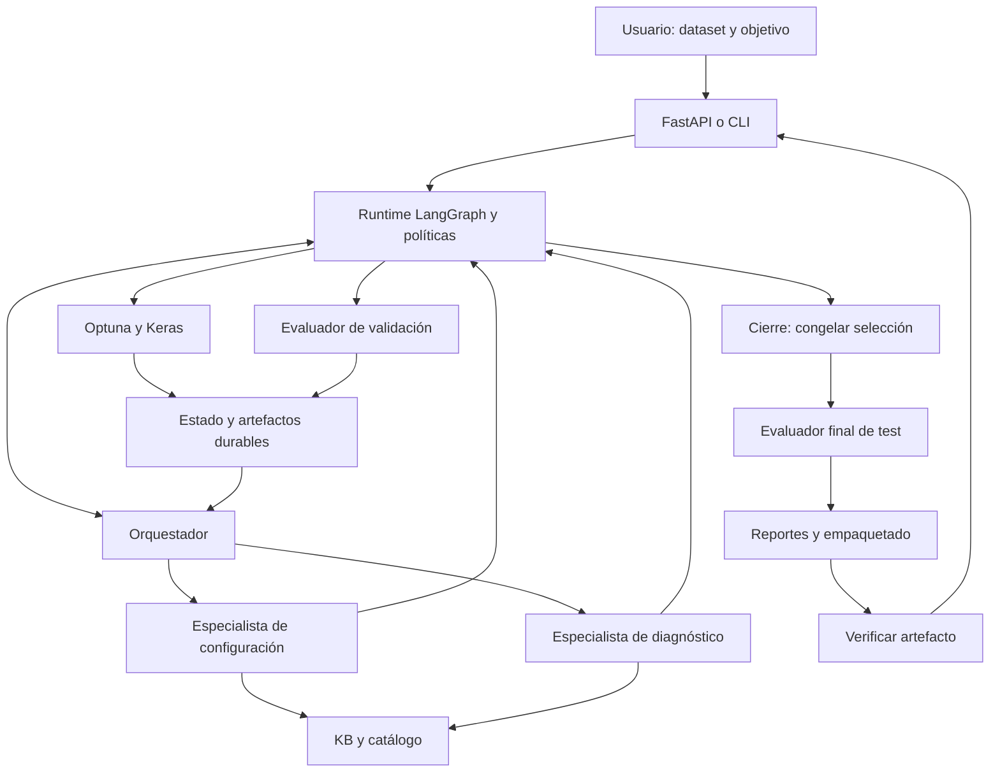
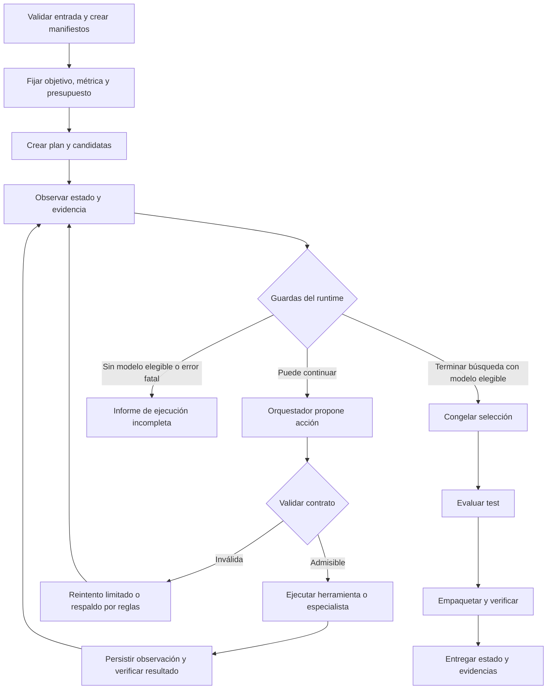

# Arquitectura propuesta: orquestador y control de flujo agéntico

Fecha de revisión: 19 de octubre de 2026. Estado: propuesta de diseño; no implementada.

Este documento propone evolucionar el prototipo hacia un **sistema multiagente jerárquico con decisiones acotadas y ejecución verificable**. Se conserva LangGraph, ChromaDB, Keras, Optuna y FastAPI. Un orquestador decide el siguiente paso a partir de observaciones reales; las herramientas de ML ejecutan operaciones tipadas y una política determinista controla sus límites.

Documentos complementarios: [hallazgos por fuente](02_propuestas_papers.md) y [hoja de ruta](03_hoja_de_ruta_y_pasos.md).

## 1. Comprensión del proyecto y alcance

El objetivo de la tesis es permitir que una pyme sin personal especializado entregue un dataset etiquetado y obtenga un clasificador de imágenes, una explicación comprensible y un artefacto preparado para despliegue. Los cuatro objetivos son acotar la búsqueda mediante RAG, automatizar entrenamiento/evaluación/ajuste, facilitar la interacción y reducir el consumo de recursos. La referencia principal es el [documento de tesis, §§1.2–1.3 y 3.6](20203540_RobertoChavez_PabloFonseca_E2.md).

El alcance operativo que se toma como base es clasificación supervisada de imágenes con carpetas por clase, selección entre arquitecturas de Keras Applications y optimización de una rejilla de hiperparámetros. La construcción actual consiste en componer un backbone y una cabeza de clasificación; no hace NAS de topologías arbitrarias. El Anexo A de la tesis todavía contiene plantillas de alcance y limitaciones: conviene completarlo con esta delimitación.

### 1.1 Estructura observada

| Área | Archivos actuales | Responsabilidad |
|---|---|---|
| Entradas | `cli.py`, `api.py`, `web/` | Carpeta o ZIP, caso de uso, recursos y presupuesto |
| Datos | `dataset.py`, `risk.py` | Perfilado, partición estratificada y señal heurística de riesgo |
| Conocimiento y propuestas | `kb.py`, `knowledge/`, `catalog.py`, `candidates.py`, `llm.py` | Recuperación, catálogo permitido y generación validada de candidatas |
| Coordinación | `pipeline.py`, `controller.py` | Grafo fijo y decisiones heurísticas entre rondas |
| Ejecución | `search.py`, `trainer.py`, `resources.py` | Estudios Optuna, entrenamiento Keras y mediciones |
| Salidas | `evaluation.py`, `benchmark.py`, `reporting.py`, `packaging.py`, `events.py` | Métricas, estimaciones de baseline, reportes, API generada y eventos |
| Verificación | `tests/` | Pruebas de candidatas, controlador, RAG, datos, API y recorrido e2e |
| Material auxiliar | `notebooks/`, `data/`, `runs/`, `papers/` | Preparación de datos, entradas, ejecuciones y bibliografía técnica |

Los módulos de código se encuentran en [src/automl_agents](../src/automl_agents/). La API sirve actualmente `web/index4.html`; hay otras variantes de la interfaz. Se debe identificar una versión canónica antes de extenderla.

### 1.2 Flujo realmente implementado


La inspección estática muestra lo siguiente; no equivale a una nueva ejecución del sistema:

| Hallazgo | Evidencia concreta | Consecuencia para el rediseño |
|---|---|---|
| El LLM no gobierna la ejecución | `Pipeline.build()` fija las aristas; `controller.decide()` aplica umbrales | Añadir una política que pueda consultar evidencia y cambiar la siguiente acción |
| El estado del grafo es insuficiente para reanudar | `State` contiene `round`, `stop`, `summary`; el resto vive en `Pipeline`; `compile()` no recibe checkpointer | Persistir referencias y decisiones; reconstruir objetos pesados al reanudar |
| El RAG se consulta al inicio | `n_retrieve()` precede a `n_propose()` y no tiene aristas de retorno | Habilitar consultas dirigidas por un diagnóstico posterior |
| Las decisiones usan exactitud | `val_accuracy` en callbacks; `val_acc` en búsqueda, controlador y selección | Definir una política de métricas coherente en todas esas capas |
| La búsqueda pierde el estado del estudio entre rondas | `SearchEngine.run_round()` crea un estudio por candidato y ronda sin storage | Persistir estudios y evitar repetir configuraciones accidentalmente |
| Un fallo de entrenamiento aborta la búsqueda | `study.optimize(..., catch=())`; captura global en `run_pipeline()` | Convertir errores conocidos en observaciones recuperables y acotadas |
| Hay registros, pero no un diario durable de trials completo | `records` vive en memoria; el historial completo se escribe en `n_report()` | Guardar cada trial y su intento inmediatamente |
| El test no determina el ganador, aunque se calcula antes de asignarlo | `n_evaluate()` usa `val_acc` para elegir entre los modelos evaluados | Conservar el criterio y hacer explícita la congelación del ganador antes del test |
| Solo se conserva el mejor modelo por candidato | `models/{candidate_id}.keras` se sobrescribe al mejorar | Separar trial, versión de candidato y checkpoint; aclarar cobertura de R2.2 |
| Las líneas base son estimaciones | `compute_benchmark()` extrapola costo medio por época | No presentar ese reporte como evidencia experimental de ahorro |
| El proveedor descrito está desactualizado | README menciona Anthropic; `llm.py` usa `google-genai` y claves Gemini/Google | Alinear documentación y registrar proveedor/modelo efectivo |

La versión actual ya aporta validación del catálogo, modo sin LLM, estratificación y selección por validación. Son bases útiles que deben conservarse. La separación del test evita usarlo para elegir, pero **no elimina el sobreajuste al conjunto de validación** por repetir la búsqueda; la frase de `reporting.write_evaluation()` debe corregirse en la implementación.

## 2. Qué significa funcionar de manera similar a Claude Code

La documentación pública de Claude Code describe un ciclo que obtiene contexto, actúa mediante herramientas y verifica resultados. El modelo decide a partir de los resultados anteriores; el software que lo rodea administra contexto y acceso a herramientas. Esa capa de ejecución se denomina *agent harness*. Esto describe su arquitectura pública, no una auditoría de su implementación interna. Fuente: [How Claude Code works](https://code.claude.com/docs/en/how-claude-code-works), consultada el 19-10-2026.

Los subagentes documentados tienen contexto, instrucciones y permisos propios; devuelven resultados al agente principal. Esta separación resulta útil cuando una subtarea produciría demasiado contexto. Fuente: [Create custom subagents](https://code.claude.com/docs/en/sub-agents).

La distinción entre flujo predefinido y agente que dirige dinámicamente sus acciones ayuda a describir la evolución propuesta. Los patrones híbridos permiten reservar la flexibilidad para decisiones que la necesitan. Fuente: [Building effective agents](https://www.anthropic.com/engineering/building-effective-agents).

La siguiente adaptación es una **decisión propia para esta tesis**:

| Concepto de referencia | Adaptación al AutoML del proyecto |
|---|---|
| Obtener contexto | Perfil, restricciones, resultados de validación y evidencia RAG relevante |
| Elegir herramientas | Consultar KB, pedir candidatas, entrenar un bloque limitado, diagnosticar, cerrar búsqueda |
| Verificar resultados | Revisar estado del trial, métricas calculadas, existencia del modelo y pruebas del artefacto |
| Mantener un plan | Plan versionado con tareas, dependencias, estados y artefactos de aceptación |
| Delegar | Especialistas en configuración y diagnóstico con contexto reducido |
| Manejar memoria | Estado durable y artefactos referenciados; resúmenes para el LLM |
| Interacción humana | Solicitar datos o una ampliación explícita del presupuesto solo cuando sea necesaria |

La semejanza buscada es el comportamiento de observar, actuar y verificar. No exige utilizar modelos Claude, copiar prompts internos, ejecutar código generado libremente, incorporar terminal generalista ni migrar de interfaz. Tampoco exige adoptar Claude Agent SDK o Deep Agents.

## 3. Arquitectura objetivo

### 3.1 Tres agentes de decisión y herramientas de ejecución

Se propone un orquestador y dos especialistas, con delegación de un solo nivel. El mismo proveedor LLM puede atender los tres roles. Su separación corresponde a contratos, contexto y permisos, no a servidores distintos.

| Componente | Decide o produce | Herramientas disponibles | Límites |
|---|---|---|---|
| **Orquestador** | Plan y siguiente acción admisible; continuar, ajustar, consultar o cerrar | Delegar, consultar resumen del estado, leer evidencia acotada, solicitar operaciones al runtime | No calcula métricas ni modifica resultados, test o presupuesto autorizado |
| **Especialista de configuración** | Candidatas y revisiones de espacios con fuentes | Consultar KB, inspeccionar catálogo y perfil de entrenamiento | Solo catálogo/rejilla; sin entrenamiento ni acceso a test |
| **Especialista de diagnóstico** | Interpretación de validación y recomendación estructurada | Leer métricas, curvas, recursos y recuperar guías | No evalúa test ni ejecuta ajustes; no declara causas no demostradas |
| **Ejecutor de entrenamiento** | Modelo y observaciones medidas | Optuna, Keras, recursos | Servicio determinista; una ejecución de entrenamiento activa |
| **Evaluador** | Métricas verificables de validación o test | Funciones de evaluación con permisos por fase | Servicio determinista; separación de entradas y salidas |
| **Reportador y empaquetador** | Informe y artefacto comprobado | Plantillas, serialización, pruebas de API | LLM opcional solo para explicación; cifras desde registros |
| **Runtime/políticas** | Autorización de transiciones, presupuesto, persistencia y recuperación | Registro de herramientas y almacén de estado | Autoridad final sobre acciones ejecutables |

Para mantener rigor conceptual: entrenamiento y evaluación pueden describirse como agentes reactivos especializados si se explicita su política, observaciones y acciones. No basta llamarlos agentes por ser funciones. En esta propuesta los tres agentes LLM tienen objetivos y contratos separados; el modo offline es un flujo determinista de respaldo, que se evalúa como tal.

### 3.2 Vista de componentes



LangGraph continúa siendo el runtime. Deep Agents es una alternativa posterior, no una dependencia inicial: ofrece capacidades de contexto y delegación, pero introducirlo no resuelve por sí mismo los contratos experimentales de AutoML. La [documentación oficial de Deep Agents](https://docs.langchain.com/oss/python/deepagents/overview) confirma esas capacidades; deben verificarse contra la versión que se instale.

## 4. Contratos y fuente de verdad

### 4.1 Estado serializable

Crear `schemas.py` con modelos validados. El estado debe contener datos pequeños o referencias, nunca modelos Keras, tensores, clientes Chroma ni manejadores de procesos.

| Grupo | Campos propuestos |
|---|---|
| Identidad | `schema_version`, `run_id`, `config_hash`, `code_revision`, `dataset_manifest_ref`, `split_manifest_ref` |
| Objetivo | `use_case`, `metric_policy`, `quality_target`, `constraints` |
| Ejecución | `phase`, `status`, `decision_step`, `search_round`, `plan_version`, `pending_action_id` |
| Plan y evidencia | `plan_ref`, `candidate_registry_ref`, `evidence_refs`, `trial_ledger_ref`, `validation_summary_ref` |
| Presupuesto | Límites, consumido y reservado de tiempo, trials, llamadas LLM, tokens y recuperaciones |
| Recuperación | `last_error`, `retry_counts`, `last_completed_action_id`, `context_summary_ref` |
| Finalización | `selection_lock_ref`, `test_report_ref`, `package_ref`, `verification_ref`, `stop_reason` |

`metric_policy` fija nombre, dirección, población de evaluación, criterio de desempate y umbral antes del primer trial. La exactitud puede mantenerse para el baseline; F1 macro es una opción para clases desbalanceadas. Si se adopta F1 macro, deben alinearse objetivo Optuna, poda, early stopping, checkpoint y selección. No basta cambiar la columna del reporte final.

### 4.2 Decisión estructurada

Ejemplo ilustrativo de propuesta de acción, no una API ya implementada:

```json
{
  "action_id": "decision-0007",
  "action": "revise_candidate",
  "candidate_id": "c2",
  "expected_candidate_version": 1,
  "arguments": {"batch_sizes": [16]},
  "evidence_refs": ["trial:c2-v1-r1-t2", "kb:guide_batch_size"],
  "rationale_summary": "El intento con batch 32 terminó por falta de memoria; 16 pertenece al espacio permitido.",
  "expected_result": "Un nuevo intento limitado que termine sin error de memoria"
}
```

El runtime comprueba tipos, fase, versiones, fuentes existentes, valores permitidos, presupuesto y ausencia de duplicados antes de ejecutar. La justificación es un resumen auditable de la decisión, no una transcripción del razonamiento interno del modelo.

### 4.3 Herramientas de dominio

| Herramienta propuesta | Entrada esencial | Salida / condición |
|---|---|---|
| `profile_and_split` | Dataset registrado y semilla | Manifiestos inmutables, validación de imágenes y perfil utilizable |
| `retrieve_evidence` | Consulta, filtros, límite de documentos/tokens | IDs, fragmentos, versión de KB y referencia al contenido completo |
| `propose_candidates` | Perfil de entrenamiento, política y evidencia | Lista validada y razones de exclusión |
| `revise_candidate` | ID, versión y cambio permitido | Nueva versión; relación con la anterior y espacio resultante |
| `run_search_batch` | Candidato/versiones y máximo de trials | IDs de intentos, estado, costo y referencias a modelos |
| `evaluate_validation` | Checkpoint y manifiesto de validación | Accuracy, F1 macro, matriz de confusión y recursos medidos |
| `diagnose_results` | Resumen de validación y evidencias | Recomendación, incertidumbres y referencias |
| `read_artifact_excerpt` | Referencia autorizada y rango | Fragmento con tamaño máximo; el rol controla qué puede leer |
| `freeze_selection` | Modelos elegibles y política fijada | Ganador, hashes y cierre irreversible de la búsqueda de esa ejecución |
| `evaluate_final` | Selección congelada y manifiesto test | Métricas finales sin arista de retorno a búsqueda |
| `package_and_verify` | Modelo congelado y metadatos | Artefacto, resultados de pruebas y estado de entrega |

Las herramientas resuelven IDs mediante un registro y no aceptan rutas arbitrarias. Documentos RAG, nombres de archivo y texto del usuario son datos; no pueden ampliar permisos ni cambiar las políticas. Las imágenes permanecen en el procesamiento local; el LLM recibe perfiles y métricas agregadas según la configuración del proyecto.

## 5. Control de flujo y condiciones de parada

### 5.1 Grafo exterior y ciclo adaptativo



El orquestador puede solicitar el cierre antes de agotar el presupuesto; esa solicitud vuelve al runtime y solo pasa a `freeze_selection` si cumple sus precondiciones. La verificación comprueba resultados del entorno: una tarea del plan no pasa a completa por una afirmación del LLM.

### 5.2 Reglas de transición

| Situación observada | Decisión admisible | Regla de ejecución |
|---|---|---|
| Evidencia insuficiente | Recuperar guías pertinentes | Tope de consultas; registrar falta de evidencia si persiste |
| Mejora útil con recursos disponibles | Asignar otro bloque de trials | Presupuesto global, no presupuesto independiente por agente |
| Candidato rezagado | Descartar o conservar justificadamente | Comparar métricas compatibles; no descartar al único elegible por error de formato |
| Sospecha de sobreajuste | Diagnosticar curvas y recomendar regularización | Es una hipótesis; requiere guardar curvas, hoy no disponibles en los registros |
| OOM | Reducir batch dentro del espacio admisible | Un reintento de recuperación por caso como valor inicial; registrar ambos intentos |
| JSON inválido o proveedor no disponible | Reintento limitado / política determinista | El fallo del LLM no autoriza saltar verificaciones |
| Acción repetida sin nueva evidencia | Rechazar y aplicar salida de respaldo | Contador de no progreso y límite total de pasos |
| Tiempo/trials agotados | Cerrar con el mejor elegible o informar ausencia de modelo | No aumentar límites automáticamente |
| Objetivo alcanzado o estancamiento | Solicitar cierre | Umbral y paciencia fijados de antemano |
| Dataset inválido o sin partición viable | Detener y explicar corrección necesaria | No reetiquetar o eliminar clases de forma silenciosa |
| Artefacto no supera pruebas | Informar fallo de empaquetado | Reintento técnico acotado; no reabrir búsqueda usando test |

Los estados terminales propuestos distinguen `completed_target_met`, `completed_budget_limited`, `failed_no_model`, `failed_artifact` y `cancelled`. Un modelo entregable por presupuesto agotado no implica que haya alcanzado la calidad deseada. `awaiting_user` es un estado persistido para una decisión externa, no un éxito.

### 5.3 Dos escalas de control

1. **Dentro del trial:** callbacks deterministas gobiernan épocas, poda, early stopping y cancelación. No se consulta al LLM por minibatch o época.
2. **Entre bloques de búsqueda:** el orquestador usa métricas y diagnósticos para asignar presupuesto, revisar espacios o consultar RAG.

La variable actual `trials_per_round` se aplica a cada candidato. Con los valores predeterminados, el techo nominal es `3 × 2 × 4 = 24` trials, antes de descartes o paradas. La nueva configuración debe exponer también `max_total_trials`, y contabilizar los intentos fallidos. El tiempo total incluye RAG, LLM, entrenamiento, evaluación y empaquetado; reservar una parte para cerrar la ejecución.

Para un límite duro de tiempo, ejecutar entrenamiento en un proceso controlable y usar timeout. Para cancelación cooperativa, comprobar la señal al finalizar cada época. Documentar la granularidad: un callback por época no garantiza un corte instantáneo.

## 6. Persistencia y contexto

### 6.1 Organización propuesta por ejecución

```text
runs/<run_id>/
  config.json
  manifest.json
  state/checkpoints.sqlite
  state/actions.sqlite
  state/optuna.sqlite
  data/dataset_manifest.json
  data/split_manifest.json
  plan/plan-v001.json
  candidates/registry.json
  evidence/<evidence_id>.json
  trials/<trial_id>/result.json
  trials/<trial_id>/history.json
  models/<trial_id>.keras
  context/summary.json
  context/history.jsonl
  events.jsonl
  reports/
  artifact/
```

Son rutas propuestas. `actions.sqlite` mantiene el diario de acciones, intentos y referencias canónicas; JSON/JSONL son evidencias exportadas. Establecer claramente qué tablas son fuente de verdad para no mantener estados incompatibles entre archivos y checkpoints.

LangGraph requiere configurar un checkpointer y una identidad de ejecución; la memoria en RAM no sobrevive a reinicios. Un backend SQLite es adecuado como punto de partida local. Fuente: [Persistence, LangGraph](https://docs.langchain.com/oss/python/langgraph/persistence).

El checkpointer no serializa automáticamente los objetos guardados en `Pipeline` ni garantiza que una escritura externa ocurra una sola vez. Se propone este protocolo:

1. Registrar una acción pendiente con `action_id` único, argumentos, versión de estado y reserva de presupuesto.
2. Antes de ejecutar, consultar si ya hay un resultado confirmado para ese ID.
3. Ejecutar; guardar artefactos temporales y publicar el archivo completo mediante reemplazo atómico.
4. Confirmar resultado y gasto, luego actualizar el checkpoint del grafo.
5. Tras un reinicio, reconciliar acciones pendientes, artefactos y estudios. No repetir ciegamente un entrenamiento cuyo resultado ya existe.

El MVP reanuda **entre trials**, no desde un minibatch. Un trial interrumpido se registra como tal y puede reiniciarse desde el principio dentro del presupuesto; ese costo no desaparece. Cada resultado debe conservar candidato, versión, ronda, estudio, trial e intento.

Para Optuna, mantener un estudio persistente por candidato y versión de espacio. Si cambian las opciones categóricas, crear una nueva versión/estudio con vínculo al anterior: no cambiar arbitrariamente las categorías de un parámetro ya usado en un estudio. La transferencia de observaciones entre estudios queda fuera del MVP hasta comprobar compatibilidad. Se evita repetir configuraciones mediante una huella que incluya dataset, split, arquitectura, parámetros, preentrenamiento y semilla; las repeticiones experimentales intencionales tienen un identificador propio.

### 6.2 Tres clases de memoria

| Memoria | Contenido | Regla |
|---|---|---|
| Conocimiento de dominio | KB curada, guías y catálogo versionados | Recuperable; cada recomendación enlaza evidencia |
| Memoria de ejecución | Plan, trials, decisiones y resultados | Durable por `run_id`; fuente de hechos medidos |
| Contexto activo del LLM | Objetivo, restricciones, resumen y últimas observaciones pertinentes | Acotado en tokens; reconstruible desde artefactos |

Mantener objetivo, política de métricas, límites y bloqueo del test fuera del resumen generado y reinyectarlos desde el estado validado. Al crecer el contexto: guardar salidas grandes, sustituirlas por referencias y resumir historial antiguo. El resumen conserva tareas pendientes, decisiones descartadas, errores y siguiente paso; los originales siguen disponibles mediante lectura por rol. La memoria entre datasets queda fuera del MVP para evitar contaminación experimental.

## 7. Validez experimental y entrega

Separar datos una sola vez y persistir hashes. El perfil exploratorio que guía al LLM se deriva del entrenamiento; la inspección global inicial se limita a integridad y viabilidad de la partición. Si existen duplicados o grupos de origen, dividir por grupos antes de iniciar experimentos.

Durante la búsqueda solo se usan entrenamiento y validación. Para R2.2, generar accuracy, F1 y matriz de confusión de validación por modelo completado. Retener esos resultados aunque después se elimine un checkpoint por política de almacenamiento. Un trial podado o fallido se identifica expresamente y no se presenta como entrenamiento completo.

Al cerrar, fijar ganador y lista de modelos de comparación antes de evaluar test. El test puede producir las tablas finales de todos esos modelos si lo requiere el protocolo, pero ningún agente de búsqueda recibe esos resultados ni puede reabrir la ejecución. Cambiar métrica, selección o hiperparámetros después de inspeccionar test invalida su papel de evaluación independiente.

El reporte distingue mediciones, estimaciones y explicaciones LLM. El empaquetado debe comprobar carga del modelo, clases, preprocesamiento y endpoints; generar un Dockerfile no demuestra que el contenedor funcione. Las cifras del reporte se generan desde resultados tipados. La comparación de ahorro incluye costo de coordinación LLM para no ocultar un sobrecosto del enfoque agéntico.

## 8. Alcance recomendado y decisiones diferidas

**MVP:** orquestador acotado, especialistas de configuración/diagnóstico, herramientas tipadas, persistencia por trial, plan versionado, RAG consultable durante el ciclo, presupuesto global, fallback determinista, evaluación separada y artefacto verificado.

**Después de medir el MVP:** compresión LLM avanzada, migración a Deep Agents, fine-tuning parcial del backbone y memoria reutilizable entre ejecuciones. Priorizar solo si mejoran resultados medidos.

**Fuera del alcance inicial:** generación libre de scripts, agentes recursivos, entrenamientos paralelos sobre la misma GPU, selección automática de datasets externos, despliegue cloud autónomo y reescritura de la UI en React. La interfaz existente puede mostrar plan, progreso, causa de parada y decisiones comprensibles.

La contribución a defender es una coordinación adaptativa, trazable y limitada por recursos para AutoML de imágenes. Su utilidad debe demostrarse frente al controlador actual; tener más agentes no constituye por sí mismo una mejora.
