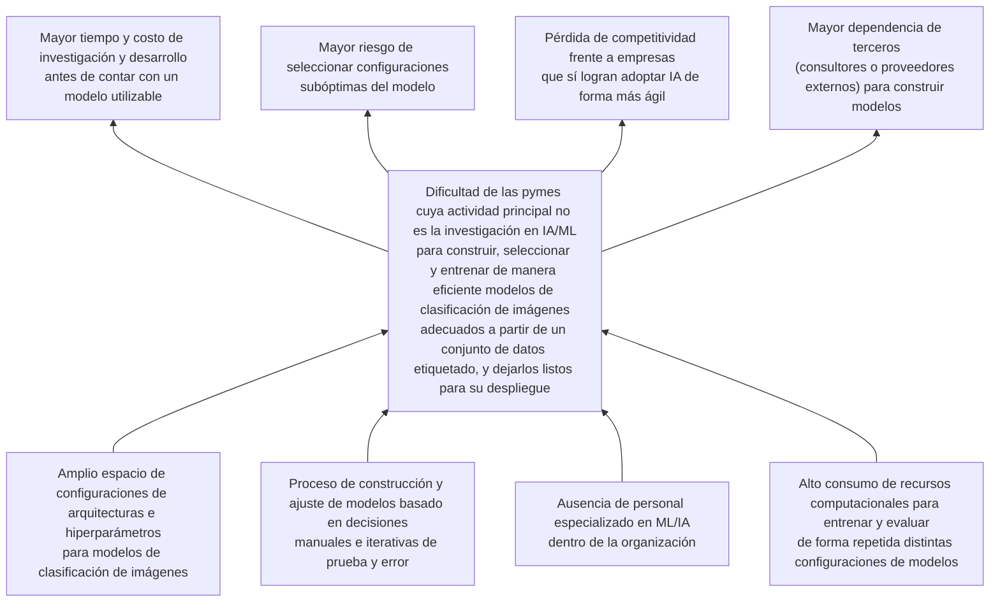
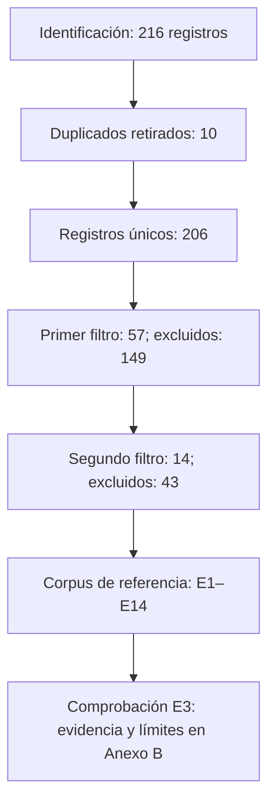
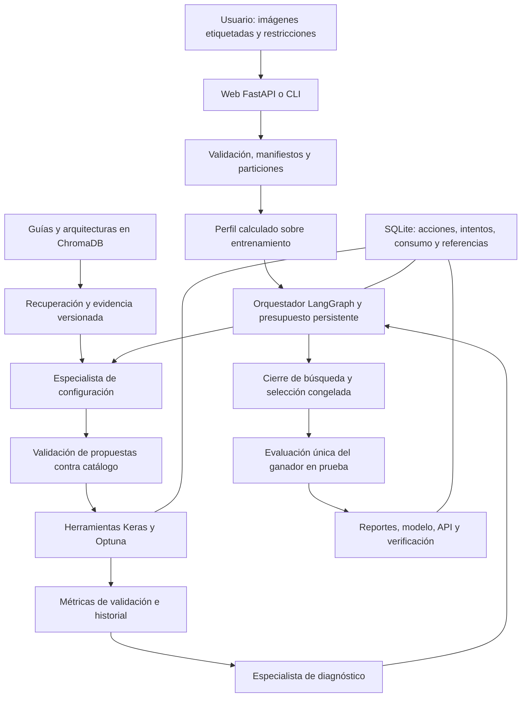
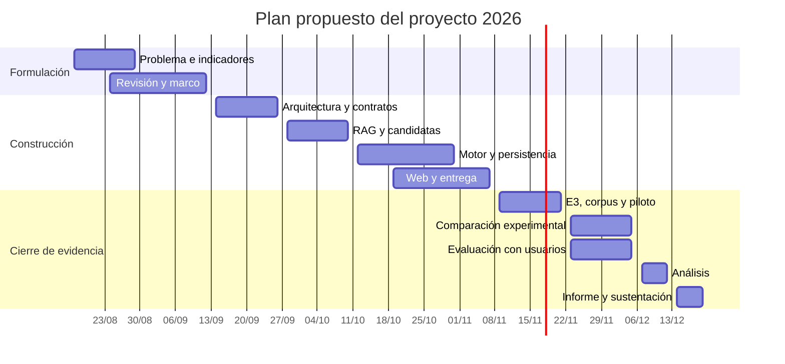

**PONTIFICIA UNIVERSIDAD CATÓLICA DEL PERÚ**

**FACULTAD DE CIENCIAS E INGENIERÍA**

# Arquitectura multiagente apoyada en generación aumentada por recuperación para automatizar la construcción de modelos de clasificación de imágenes orientada a pymes

**Proyecto de Fin de Carrera 1 — Entregable 3**

**Autor:** Roberto Abel Chavez Javier — código 20203540  
**Asesor:** Pablo Alejandro Fonseca Arroyo  
**Lima, noviembre de 2026**  
**Fecha de corte de la evidencia:** 10 de noviembre de 2026

# Resumen

La construcción de modelos de clasificación de imágenes exige seleccionar arquitecturas, configurar el entrenamiento, comparar resultados y preparar un servicio de inferencia. Estas actividades dificultan la adopción del aprendizaje automático en pequeñas y medianas empresas que disponen de datos etiquetados, pero carecen de personal especializado y de capacidad para sostener una experimentación extensa. Este proyecto desarrolla una arquitectura multiagente apoyada en generación aumentada por recuperación para acotar configuraciones, automatizar su evaluación y entregar un modelo acompañado de reportes comprensibles.

La propuesta integra un orquestador y especialistas de configuración y diagnóstico con una base de conocimiento, herramientas de entrenamiento supervisado, optimización de hiperparámetros y persistencia de decisiones. La evaluación distingue la verificación funcional del sistema, la calidad predictiva, la recuperación documental, la eficiencia computacional y la usabilidad. El conjunto de prueba se reserva hasta congelar la selección del modelo.

El avance implementado comprende el recorrido desde la carga de imágenes hasta una interfaz de programación de aplicaciones (API) exportada, con seguimiento, cancelación y reanudación. En una muestra local de 1 000 imágenes de dígitos manuscritos MNIST, una red convolucional pequeña alcanza 97,26 % de exactitud en validación y 95,21 % en prueba. Esta ejecución utiliza reglas, por lo que no demuestra una ventaja causal de los agentes o de RAG. La recuperación léxica obtiene precisión@3 de 0,467 en diez consultas. La evaluación semántica, la comparación con una búsqueda exhaustiva real y el estudio con usuarios permanecen programados. Se concluye que existe viabilidad funcional del prototipo y evidencia inicial de calidad predictiva, mientras que los beneficios de eficiencia y accesibilidad requieren validación experimental adicional.

**Palabras clave:** AutoML, clasificación de imágenes, sistemas multiagente, RAG, pymes.

# Tabla de contenido

- [Capítulo 1. Generalidades](#capítulo-1-generalidades): problemática, objetivos, resultados, indicadores y métodos.
- [Capítulo 2. Marco legal, regulatorio y conceptual](#capítulo-2-marco-legal-regulatorio-y-conceptual).
- [Capítulo 3. Estado del arte](#capítulo-3-estado-del-arte): protocolo, selección, extracción, síntesis y productos similares.
- [Capítulo 4. Avance de los resultados](#capítulo-4-avance-de-los-resultados): arquitectura, construcción, validación y límites.
- [Capítulo 5. Conclusiones y trabajos futuros](#capítulo-5-conclusiones-y-trabajos-futuros).
- [Referencias](#referencias).
- [Anexo A. Plan de proyecto](#anexo-a-plan-de-proyecto): viabilidad, alcance, riesgos, EDT, tareas, cronograma, recursos y costos.
- [Anexo B. Formulario de extracción bibliográfica completado](#anexo-b-formulario-de-extracción-bibliográfica-completado).
- [Anexo C. Protocolo de evaluación experimental y con usuarios](#anexo-c-protocolo-de-evaluación-experimental-y-con-usuarios).
- [Anexo D. Evidencias y trazabilidad de evaluación](#anexo-d-evidencias-y-trazabilidad-de-evaluación).

El informe presenta un proyecto completo en su formulación y planificación, junto con el avance verificable del prototipo. «Implementado» describe una capacidad existente; «verificado» exige evidencia identificable; «meta» identifica un compromiso de evaluación, no un resultado obtenido. El Anexo A contiene la planificación del cierre y el Anexo D permite localizar la evidencia de cada afirmación técnica.

# Capítulo 1. Generalidades

## 1.1 Problemática

Durante la última década, el aprendizaje profundo (*deep learning*) se ha convertido en el enfoque dominante para resolver tareas de clasificación de imágenes, pero construir un modelo con buen desempeño para un conjunto de datos etiquetado específico continúa siendo un proceso costoso: exige diseñar o elegir una arquitectura, ajustar sus hiperparámetros, entrenarla y validarla, habitualmente mediante ciclos iterativos de prueba y error (Elsken et al., 2019; Xue et al., 2025). Este proceso involucra un espacio de configuraciones (arquitecturas, hiperparámetros de entrenamiento, estrategias de preprocesamiento) tan amplio que explorarlo manualmente resulta poco escalable, incluso para practicantes con experiencia (Xue et al., 2025).

Precisamente para reducir esta carga manual surgió el aprendizaje automático automatizado (*automated machine learning*, AutoML), un campo orientado a automatizar el flujo de trabajo de construcción de modelos, desde el preprocesamiento hasta la selección de arquitectura y el ajuste de hiperparámetros, con el fin de disminuir la dependencia de conocimiento técnico especializado (He et al., 2021; Karmaker Santu et al., 2022). Sin embargo, el propio desarrollo del *AutoML* confirma que la selección de un modelo adecuado no es un problema trivial: sigue requiriendo comprender los datos del dominio, definir el problema de predicción y elegir una técnica de aprendizaje prometedora, pasos que suelen implicar un proceso iterativo entre el usuario y la herramienta (Karmaker Santu et al., 2022).

Esta dificultad técnica tiene un correlato organizacional. La literatura sobre adopción de inteligencia artificial (IA) en empresas señala de forma consistente que la falta de conocimiento y de personal especializado en IA y aprendizaje automático (*machine learning*, ML) es una de las barreras más citadas para adoptar estas tecnologías, particularmente en pequeñas y medianas empresas (pymes) cuya actividad principal no es la investigación en IA (Ayinaddis, 2025). A diferencia de las grandes organizaciones, que cuentan con equipos propios de investigación y desarrollo (I+D) capaces de asumir el costo de experimentar con modelos de aprendizaje profundo, las pymes suelen carecer de esa capacidad técnica y de los recursos computacionales necesarios para sostener ciclos de experimentación prolongados (Ayinaddis, 2025; Karmaker Santu et al., 2022). Esta asimetría se traduce en una brecha de adopción de IA entre empresas grandes y pequeñas, y en una presión competitiva sobre estas últimas, ya que las organizaciones que sí logran incorporar IA de forma más ágil ganan ventajas frente a las que no pueden hacerlo (Ayinaddis, 2025).

En consecuencia, el problema no debe entenderse como la ausencia de una aplicación o de un sistema informático puntual, sino como una dificultad estructural: las pymes cuya actividad principal no es la IA/ML enfrentan una dificultad real para construir, seleccionar, entrenar y dejar listos para su despliegue modelos de clasificación de imágenes adecuados a partir de un conjunto de datos etiquetado, debido a la combinación de un espacio de configuración amplio, un proceso manual e iterativo, y la falta de conocimiento especializado y de recursos computacionales dentro de la organización.

### 1.1.1 Árbol de Problemas

Para organizar la problemática, se emplea la técnica del árbol de problemas, la cual permite identificar las causas directas del problema central y sus efectos (Ortegón et al., 2005). En la Figura 1 se plantea el árbol de problemas de la problemática encontrada.

**Figura 1**

*Árbol de problemas*



### 1.1.2 Descripción

Las cuatro causas se agrupan en dos dimensiones. Por un lado, hay causas de naturaleza técnica: el espacio de configuraciones posibles (arquitecturas, hiperparámetros) para un modelo de clasificación de imágenes es amplio, y explorarlo hoy en día depende de un proceso manual e iterativo de prueba y error, lo cual es intrínsecamente lento y demandante incluso para especialistas (Elsken et al., 2019; Xue et al., 2025). Por otro lado, hay causas de naturaleza organizacional, propias de empresas cuya actividad principal no es la IA: la falta de personal especializado en ML/IA y la falta de recursos computacionales suficientes para sostener múltiples ciclos de entrenamiento y evaluación, ambas reportadas como barreras recurrentes para la adopción de IA en pymes (Ayinaddis, 2025; He et al., 2021). La combinación de estas cuatro causas configura el problema central: estas empresas enfrentan una dificultad real para construir, seleccionar y entrenar modelos de clasificación de imágenes adecuados a partir de sus propios datos etiquetados, y para dejarlos en un estado listo para desplegarse, sin tener que igualar la capacidad técnica y de infraestructura de una gran empresa con equipo propio de I+D (Karmaker Santu et al., 2022). De no resolverse, este problema central deriva en cuatro efectos. En el corto plazo, se traduce en mayor tiempo y costo de investigación y desarrollo antes de disponer de un modelo utilizable y en un mayor riesgo de terminar con una configuración de modelo subóptima, es decir, con menor exactitud o eficiencia de la que sería alcanzable (Xue et al., 2025). En el mediano plazo, la empresa queda en desventaja frente a otras organizaciones, grandes o pequeñas, que sí logran adoptar e iterar sobre soluciones de IA con mayor agilidad, lo que se traduce en pérdida de competitividad, o termina dependiendo de consultores y proveedores externos para poder construir sus propios modelos, profundizando la brecha de capacidades internas (Ayinaddis, 2025).

### 1.1.3 Problema seleccionado

El problema seleccionado para la presente investigación es la **dificultad de las pequeñas y medianas empresas (pymes) cuya actividad principal no es la investigación en inteligencia artificial (IA) o *machine learning* (ML) para construir, seleccionar y entrenar de manera eficiente modelos adecuados de clasificación de imágenes a partir de un conjunto de datos etiquetado, y dejarlos listos para su despliegue.**

Este problema se selecciona porque concentra, en un único enunciado, las dos causas técnicas (amplio espacio de configuración y proceso manual/iterativo de construcción de modelos) y las dos causas organizacionales (falta de personal especializado y de recursos computacionales) identificadas en el árbol, y porque acota el alcance de la solución a un tipo de organización concreto, empresas cuyo negocio principal no es la IA, en lugar de dejarlo abierto a cualquier actor (grande, pequeño, con o sin equipo de I+D propio). Esta acotación es la que permite, en los siguientes capítulos, plantear una solución igualmente delimitada: una arquitectura multiagente que, apoyada en generación aumentada por recuperación (*retrieval-augmented generation*, RAG), automatice la selección, entrenamiento y evaluación de modelos de clasificación de imágenes para este tipo de empresas.

### 1.1.4 Situación deseada y delimitación de la intervención

La situación deseada es que una persona responsable de los datos pueda cargar imágenes etiquetadas, declarar su caso de uso y fijar un presupuesto; el sistema debe proponer configuraciones válidas, entrenarlas, seleccionar con validación y entregar un servicio de inferencia con evidencia de su desempeño y sus límites. El resultado esperado es una reducción de decisiones técnicas manuales dentro de ese recorrido. El proyecto no sustituye la definición de las clases, la responsabilidad sobre los datos ni la decisión empresarial de usar el modelo.

El árbol constituye un modelo causal sustentado en literatura, no una medición de prevalencia en pymes peruanas. Los ejemplos de reciclaje, comercio y control de calidad son escenarios de aplicación; no se presentan como empresas participantes ni como entrevistas realizadas. La necesidad técnica se aborda mediante recuperación documental, selección dentro de un catálogo finito, entrenamiento controlado y evaluación reproducible. Los efectos sobre competitividad y dependencia de terceros son motivaciones de largo plazo y no variables que esta tesis se comprometa a demostrar.

## 1.2 Objetivos

En esta sección se definen el objetivo general y los cuatro objetivos específicos que se desprenden del análisis de la problemática presentada en la sección 1.1, cada uno orientado a atender una de las cuatro causas identificadas en el árbol de problemas, así como los resultados esperados de cada objetivo y el mapeo de verificación que permitirá evaluar objetivamente el cumplimiento de dichos resultados.

### 1.2.1 Objetivo general

Conforme al análisis de la problemática presentada, se define como objetivo general del proyecto: **“Desarrollar una arquitectura multiagente, apoyada en generación aumentada por recuperación (RAG), que automatice la construcción, selección, entrenamiento y preparación para el despliegue de modelos de clasificación de imágenes a partir de un conjunto de datos etiquetado, orientada a pequeñas y medianas empresas (pymes) cuya actividad principal no es la investigación en inteligencia artificial (IA) o *machine learning* (ML).”**

### 1.2.2 Objetivos específicos

Durante el análisis detallado del objetivo general se determinaron cuatro objetivos específicos, uno por cada causa identificada en el árbol de problemas, los cuales se describen en la Tabla 1.

**Tabla 1**

*Tabla de objetivos específicos*

| Código | Objetivo específico | Causa que atiende |
|---|---|---|
| O1 | Diseñar un mecanismo, apoyado en RAG, que acote de manera automática el espacio de arquitecturas e hiperparámetros de modelos de clasificación de imágenes a un conjunto reducido de configuraciones candidatas relevantes para el conjunto de datos del usuario. | Amplio espacio de configuraciones de arquitecturas e hiperparámetros para modelos de clasificación de imágenes |
| O2 | Automatizar, mediante una arquitectura multiagente, el ciclo de entrenamiento, evaluación y ajuste de las configuraciones candidatas, sin requerir intervención manual continua del usuario. | Proceso de construcción y ajuste de modelos basado en decisiones manuales e iterativas de prueba y error |
| O3 | Diseñar un mecanismo de interacción que permita a usuarios sin conocimientos especializados en ML/IA proporcionar su conjunto de datos y requerimientos, y recibir el modelo resultante junto con una explicación comprensible de las decisiones tomadas por el sistema. | Ausencia de personal especializado en ML/IA dentro de la organización |
| O4 | Optimizar el consumo de recursos computacionales durante la búsqueda, entrenamiento y evaluación de las configuraciones candidatas, de modo que el proceso completo sea viable con los recursos limitados típicos de una pyme. | Alto consumo de recursos computacionales para entrenar y evaluar de forma repetida distintas configuraciones de modelos |

### 1.2.3 Resultados esperados

A continuación, se describe cada objetivo específico junto con los resultados concretos que se espera obtener al alcanzarlo. Estos resultados constituyen los entregables verificables del proyecto y serán la base del mapeo de verificación presentado en la sección 1.2.4.

**O1. Acotar el espacio de configuraciones de modelos mediante RAG**

Este objetivo busca reducir, con apoyo de una base de conocimiento recuperable, el amplio espacio de arquitecturas e hiperparámetros posibles a un subconjunto acotado y justificado de configuraciones candidatas para el conjunto de datos de imágenes proporcionado por el usuario.

- **Resultado 1 del objetivo 1 (R1.1):** Base de conocimiento (RAG) que indexa documentación técnica, buenas prácticas y arquitecturas de referencia para clasificación de imágenes, consultable por los agentes del sistema.

- **Resultado 2 del objetivo 1 (R1.2):** Componente que, a partir del conjunto de datos etiquetado y las clases del usuario, genera un conjunto acotado de configuraciones candidatas (arquitecturas e hiperparámetros).

- **Resultado 3 del objetivo 1 (R1.3):** Reporte automático de los criterios usados para acotar el espacio de búsqueda y de las configuraciones descartadas.

**O2. Automatizar el ciclo de entrenamiento, evaluación y ajuste**

Este objetivo busca eliminar la dependencia de ciclos manuales de prueba y error, delegando en agentes especializados la ejecución, evaluación y ajuste iterativo de las configuraciones candidatas generadas en O1.

- **Resultado 1 del objetivo 2 (R2.1):** Agente de entrenamiento que ejecuta de forma automática el entrenamiento de cada configuración candidata sobre el conjunto de datos del usuario.

- **Resultado 2 del objetivo 2 (R2.2):** Agente de evaluación que mide y compara el desempeño de los modelos entrenados bajo métricas estandarizadas (p. ej., exactitud, *F1-score*).

- **Resultado 3 del objetivo 2 (R2.3):** Mecanismo de iteración automática que, con base en los resultados de evaluaciones previas, decide continuar, ajustar o descartar configuraciones sin intervención humana.

**O3. Facilitar el uso del sistema a usuarios sin conocimientos especializados**

Este objetivo busca que una persona sin formación en ML/IA pueda utilizar el sistema de principio a fin, entregando como resultado un modelo entrenado y una explicación de las decisiones tomadas en un lenguaje comprensible para un usuario no técnico.

- **Resultado 1 del objetivo 3 (R3.1):** Interfaz de entrada mediante la cual el usuario carga su conjunto de datos como archivo ZIP con una carpeta por clase y define sus clases, sin requerir conocimientos técnicos de ML.

- **Resultado 2 del objetivo 3 (R3.2):** Reporte final, en lenguaje no técnico, que explica el modelo seleccionado, su desempeño esperado y las razones detrás de la selección.

- **Resultado 3 del objetivo 3 (R3.3):** Artefacto final del modelo entrenado (p. ej., una interfaz de programación de aplicaciones (*application programming interface*, API) empaquetada en un contenedor Docker) entregado listo para su despliegue, sin editar el código del modelo, en un equipo de prueba con Docker instalado y recursos suficientes.

**O4. Optimizar el consumo de recursos computacionales del proceso**

Este objetivo busca que la automatización propuesta en O1 y O2 sea viable en la práctica para una pyme, evitando que el ahorro de tiempo de las personas se traduzca en un consumo de cómputo desproporcionado.

- **Resultado 1 del objetivo 4 (R4.1):** Estrategia de priorización o descarte temprano de configuraciones candidatas que reduce el número de entrenamientos completos necesarios.

- **Resultado 2 del objetivo 4 (R4.2):** Registro del consumo de recursos (tiempo de cómputo, uso de la unidad central de procesamiento (*central processing unit*, CPU) y de la unidad de procesamiento gráfico (*graphics processing unit*, GPU)) asociado a cada configuración evaluada durante el proceso.

- **Resultado 3 del objetivo 4 (R4.3):** Reporte comparativo del consumo de recursos del proceso automatizado frente a un proceso de búsqueda manual o exhaustivo tomado como referencia (línea base).

### 1.2.4 Mapeo de objetivos, resultados y verificación

Con el fin de asegurar que cada resultado esperado pueda evaluarse de forma objetiva al final del proyecto, a continuación, se detalla el mapeo correspondiente a cada uno de los cuatro objetivos específicos, indicando para cada resultado su medio de verificación (dónde y cómo se comprobará su existencia) y su indicador objetivamente verificable (IOV; con qué criterio medible se dará por cumplido). A continuación, la Tabla 2 detalla el mapeo correspondiente al primer objetivo específico del proyecto, orientado al acotamiento del espacio de configuraciones.

**Tabla 2**

*Tabla de mapeo de resultados y verificación del objetivo 1*

**Objetivo O1: Acotar el espacio de configuraciones de modelos mediante RAG**

| Resultado | Medio de verificación | Indicador objetivamente verificable |
|---|---|---|
| R1.1. Base de conocimiento RAG de arquitecturas y configuraciones | Repositorio del proyecto con la base de conocimiento indexada y el código del módulo de recuperación | Al menos 10 consultas de prueba, con precisión media@3 ≥ 0.70 frente a un conjunto de referencia etiquetado manualmente |
| R1.2. Conjunto acotado de configuraciones candidatas | Registros de ejecución con las configuraciones generadas por el sistema para los conjuntos de datos de prueba | Reducción ≥ 90 % del número de combinaciones válidas de arquitectura e hiperparámetros en cada conjunto de datos de prueba, con un máximo de 5 candidatas; el conteo se define en la sección 2.4.2.4 |
| R1.3. Reporte de criterios de acotación | Reporte generado automáticamente por el sistema al final de cada ejecución | Reporte generado en el 100 % de las ejecuciones (mínimo 3 conjuntos de datos de prueba), incluyendo criterios de acotación y configuraciones descartadas con su motivo |

La Tabla 3 detalla el mapeo del segundo objetivo específico del proyecto, orientado a la automatización que propone la solución.

**Tabla 3**

*Tabla de mapeo de resultados y verificación del objetivo 2*

**Objetivo O2: Automatizar el ciclo de entrenamiento, evaluación y ajuste**

| Resultado | Medio de verificación | Indicador objetivamente verificable |
|---|---|---|
| R2.1. Agente de entrenamiento automático | Registros de ejecución del agente de entrenamiento | Al menos el 90 % de las candidatas admitidas a entrenamiento completan un ensayo sin intervención manual, por conjunto de datos; fallos y podas se informan por separado. |
| R2.2. Agente de evaluación de modelos | Tablas comparativas de métricas generadas automáticamente por el agente evaluador | Exactitud, F1 macro y matriz de confusión de validación registradas para el 100 % de los modelos con entrenamiento completado; prueba final únicamente para el ganador. |
| R2.3. Mecanismo de iteración automática | Historial de iteraciones del sistema (configuración evaluada, resultado obtenido, ajuste aplicado) | Al menos 3 ciclos de evaluación–decisión–ajuste en una prueba controlada por conjunto de datos, con presupuesto suficiente y sin alcanzar antes el objetivo; el resto de ejecuciones debe justificar su cierre. |

La Tabla 4 detalla el mapeo del tercer objetivo específico del proyecto, orientado a la usabilidad del sistema para los usuarios.

**Tabla 4**

*Tabla de mapeo de resultados y verificación del objetivo 3*

**Objetivo O3: Facilitar el uso del sistema a usuarios sin conocimientos especializados**

| Resultado | Medio de verificación | Indicador objetivamente verificable |
|---|---|---|
| R3.1. Interfaz de carga de conjuntos de datos | Prototipo funcional de la interfaz, probado con usuarios sin experiencia en ML | Al menos el 80 % de una muestra de n = 5 usuarios sin experiencia en ML completan la carga del conjunto de datos y la definición de clases sin asistencia técnica, y el puntaje promedio de la Escala de Usabilidad del Sistema (*System Usability Scale*, SUS) es ≥ 68. |
| R3.2. Reporte final comprensible | Reportes generados por el sistema durante pruebas con usuarios | Al menos el 80 % de la misma muestra califica la comprensión del reporte, en base a cuestionario proporcionado, con 4 o más en una escala Likert de 1 a 5, sin apoyo técnico |
| R3.3. Artefacto final listo para despliegue | Artefacto (API dockerizada) entregado al finalizar una ejecución de prueba | Contenedor desplegado en entorno de prueba y 100 % de las pruebas básicas de funcionamiento aprobados en los puntos de acceso definidos, sin editar el código exportado, con Docker disponible |

La Tabla 5 detalla el mapeo del cuarto objetivo específico del proyecto, orientado a la optimización de recursos.

**Tabla 5**

*Tabla de mapeo de resultados y verificación del objetivo 4*

**Objetivo O4: Optimizar el consumo de recursos computacionales del proceso**

| Resultado | Medio de verificación | Indicador objetivamente verificable |
|---|---|---|
| R4.1. Estrategia de priorización/descarte temprano | Código y documentación de la estrategia implementada | Reducción ≥ 50 % del número de entrenamientos completos frente a la búsqueda exhaustiva de referencia, con una pérdida de exactitud ≤ 3 puntos porcentuales |
| R4.2. Registro de consumo de recursos | Registro de tiempo de cómputo y uso de CPU/GPU por configuración evaluada | Registro de tiempo y CPU para el 100 % de los intentos; GPU registrada cuando esté disponible y ausencia identificada explícitamente |
| R4.3. Reporte comparativo de consumo de recursos | Reporte comparativo entre el proceso automatizado y un proceso manual/exhaustivo de referencia | Reducción ≥ 40 % del tiempo total de cómputo frente a la línea base manual o exhaustivo, medida en los mismos conjuntos de datos y *hardware* |

Las metas numéricas de los IOV se definieron con los siguientes criterios. Primero, se establece una única muestra de usuarios de prueba para R3.1 y R3.2, conformada por 5 personas sin experiencia en ML/IA, idealmente vinculadas a pymes; el porcentaje de usuarios de los indicadores de ambos resultados se calcula siempre sobre esa muestra. Segundo, los conjuntos de datos de prueba son al menos tres conjuntos de datos etiquetados de clasificación de imágenes, y los mismos se emplean en la evaluación de los resultados de los objetivos O1, O2 y O4, de modo que las comparaciones sean consistentes. Tercero, la precisión (R1.1) se entiende como la proporción de los tres documentos recuperados por consulta que son relevantes según el conjunto de referencia. Cuarto, el umbral de 68 puntos en la Escala de Usabilidad del Sistema (SUS) se toma como el valor de referencia de usabilidad promedio reportado en la literatura (Sauro, 2011), sobre la escala creada por Brooke (1996). Los demás umbrales (por ejemplo, la reducción de 90 % del espacio de búsqueda o de 50 % de los entrenamientos completos) se plantean como metas de partida. Cualquier ajuste motivado por pruebas preliminares se documentará antes de la evaluación final, conservando los valores originales y su justificación. Los métodos de validación correspondientes se detallan en la siguiente sección.

## 1.3 Métodos y Procedimientos

En esta sección se detalla, para cada uno de los doce resultados esperados definidos en la sección 1.2.3, al menos una herramienta o método concreto mediante el cual se obtendrá, así como la forma en que se validará su cumplimiento. La organización sigue la misma agrupación por objetivo específico empleada en las tablas de mapeo de verificación (sección 1.2.4), de modo que cada tabla de métodos pueda leerse en conjunto con su tabla de verificación correspondiente. En la Tabla 6 se describe brevemente las herramientas o métodos seleccionados del objetivo 1.

**Tabla 6**

*Tabla de métodos y herramientas para los resultados del objetivo 1*

| Resultado | Herramienta o método | Forma de validación |
|---|---|---|
| R1.1. Base de conocimiento RAG | Generación aumentada por recuperación (RAG) sobre una base de datos vectorial (ChromaDB), con el modelo multilingüe de representaciones vectoriales (*embeddings*) `sentence-transformers/paraphrase-multilingual-MiniLM-L12-v2` para indexar documentación técnica y arquitecturas de referencia | Ejecución de consultas de prueba contra la base de conocimiento, midiendo precisión y exhaustividad de los documentos recuperados frente a un conjunto de referencia etiquetado manualmente |
| R1.2. Conjunto acotado de configuraciones candidatas | Agente generador de configuraciones basado en un modelo de lenguaje de gran tamaño (*large language model*, LLM), Gemini 3.8 Flash (`gemini-3.8-flash`) mediante la API de Gemini, orquestado como grafo de estados con LangGraph, que combina la salida del componente RAG con el catálogo de arquitecturas preentrenadas de Keras Applications | Comparación cuantitativa entre el tamaño del espacio de búsqueda total considerado y el del subconjunto de configuraciones generado, más revisión cualitativa de su pertinencia con el asesor |
| R1.3. Reporte de criterios de acotación | Generación automática de reportes estructurados (plantillas en Markdown y en el formato de intercambio de datos *JavaScript Object Notation*, JSON) a partir de los registros de ejecución del agente generador | Verificación automatizada (conjunto de pruebas) de que el reporte se genera correctamente en el 100 % de las ejecuciones de prueba |

La base de conocimiento (R1.1) se apoya en el paradigma de generación aumentada por recuperación (RAG), que combina un modelo de lenguaje preentrenado con un mecanismo de recuperación sobre una memoria no paramétrica externa para condicionar sus respuestas en información explícita y actualizable (Lewis et al., 2020). Para implementar esta memoria no paramétrica se empleará ChromaDB, una base de datos vectorial de código abierto orientada a aplicaciones de IA que permite almacenar e indexar *embeddings* de documentos y recuperarlos por similitud semántica (Chroma, s. f.). Sobre esta base de conocimiento se construye el agente generador de configuraciones (R1.2), coordinado mediante LangGraph, un marco de desarrollo para construir aplicaciones multiagente con estado como grafos cíclicos de nodos y aristas, lo que permite modelar bucles de razonamiento y decisión propios de un agente (LangChain AI, s. f.).

El catálogo de arquitecturas candidatas se ancla en Keras Applications, el módulo de modelos preentrenados de la librería Keras utilizado como referencia de catálogo de modelos para clasificación de imágenes (Chollet, 2015). Finalmente, el reporte de criterios de acotación (R1.3) se obtiene generando automáticamente, al final de cada ejecución, un documento estructurado con los registros del agente, siguiendo el mismo principio de trazabilidad documental que sustenta el protocolo de revisión estructurada aplicado en el capítulo 3 (Kitchenham & Charters, 2007).

En la Tabla 7 se describe brevemente las herramientas o métodos seleccionados del objetivo 2.

**Tabla 7**

*Tabla de métodos y herramientas para los resultados del objetivo 2*

| Resultado | Herramienta o método | Forma de validación |
|---|---|---|
| R2.1. Agente de entrenamiento automático | Entrenamiento supervisado de modelos de clasificación de imágenes con TensorFlow/Keras, ejecutado por herramientas coordinadas desde LangGraph, con una GPU local NVIDIA GTX 1650 prevista y Google Colab como entorno complementario previsto para experimentos de entrenamiento. | Revisión de los registros de ejecución para determinar el porcentaje de configuraciones entrenadas sin intervención manual del usuario |
| R2.2. Agente de evaluación de modelos | Cálculo de métricas estandarizadas de desempeño (exactitud, *F1-score*, matriz de confusión) con la librería scikit-learn | Verificación de que las métricas de desempeño quedan registradas para el 100 % de los modelos entrenados, mediante tablas comparativas generadas automáticamente |
| R2.3. Mecanismo de iteración automática | Política de decisión agéntica apoyada en optimización de hiperparámetros mediante búsqueda bayesiana con Optuna, incluyendo descarte temprano tipo Hyperband | Revisión del historial de iteraciones del sistema, contabilizando el número de iteraciones ejecutadas sin intervención humana |

El componente de entrenamiento (R2.1) se apoya en TensorFlow/Keras, marco de desarrollo de referencia para la construcción y el entrenamiento de redes neuronales profundas (Chollet, 2015), con ejecución local y una GPU NVIDIA GTX 1650 prevista para las configuraciones más ligeras. Se prevé emplear Google Colab como servicio complementario para los experimentos de entrenamiento que excedan la memoria local, con el mismo código, particiones de datos y configuración experimental. La inferencia del modelo de lenguaje se realizará por separado mediante la API de Gemini. Colab proporciona cuadernos alojados con acceso a aceleradores, pero su disponibilidad, tipo de GPU y límites de sesión son variables; por ello se registrará el equipo efectivamente asignado, sin asumir una GPU específica ni disponibilidad continua (Google, s. f.-a). El uso de Colab se plantea como entorno experimental iniciado desde un cuaderno, no como servicio permanente de alojamiento de la aplicación ni como migración automática de tareas ya implementada. El componente de evaluación (R2.2) emplea scikit-learn, librería de Python ampliamente utilizada para el cálculo estandarizado de métricas de aprendizaje automático como exactitud y *F1-score* (Pedregosa et al., 2011), lo que garantiza que todas las configuraciones candidatas se comparen bajo el mismo criterio objetivo. El mecanismo de iteración automática (R2.3) integrará Optuna, un marco de desarrollo de optimización de hiperparámetros de próxima generación que permite definir de forma programática el espacio de búsqueda y podar automáticamente las configuraciones poco prometedoras (Akiba et al., 2019), apoyado en el principio de asignación adaptativa de recursos de Hyperband, que descarta tempranamente las configuraciones de peor desempeño parcial para concentrar el cómputo en las más prometedoras (Li et al., 2018); este mismo principio de descarte temprano se reutiliza en el objetivo 4 (R4.1) para optimizar el consumo de recursos.

En la Tabla 8 se describe brevemente las herramientas o métodos seleccionados del objetivo 3.

**Tabla 8**

*Tabla de métodos y herramientas para los resultados del objetivo 3*

| Resultado | Herramienta o método | Forma de validación |
|---|---|---|
| R3.1. Interfaz de carga de conjuntos de datos | Prototipo de interfaz web ligera servida por FastAPI para carga de conjuntos de datos y definición de clases, evaluado con la Escala de Usabilidad del Sistema (SUS), incluyendo una advertencia sobre datos personales | Pruebas de usabilidad con usuarios sin experiencia en ML, midiendo el porcentaje que completa la carga sin asistencia técnica y el puntaje SUS obtenido |
| R3.2. Reporte final comprensible | Generación mediante plantillas en lenguaje no técnico a partir de las métricas y decisiones registradas, siguiendo la estructura de una ficha de modelo (*model card*) | Encuestas de comprensión aplicadas a usuarios de prueba tras leer el reporte, midiendo el porcentaje que declara comprenderlo sin apoyo técnico adicional |
| R3.3. Artefacto final listo para despliegue | Contenerización del modelo entrenado con Docker y exposición como servicio mediante una API construida con FastAPI | Despliegue del contenedor en un entorno de prueba y ejecución de pruebas funcionales (pruebas básicas de funcionamiento) sobre los puntos de acceso de la API |

La interfaz de carga de conjuntos de datos (R3.1) se validará con la Escala de Usabilidad del Sistema (SUS), un cuestionario breve y de aplicación rápida, ampliamente utilizado en ingeniería de *software* para obtener una medida confiable de la usabilidad percibida de un sistema con un número reducido de usuarios de prueba (Brooke, 1996). Para el reporte final comprensible (R3.2) se emplearán plantillas que convierten las métricas técnicas y las decisiones registradas en explicaciones accesibles para personas sin formación en ML/IA, de acuerdo con la implementación del proyecto. Las cifras provendrán de los resultados persistidos. Se adoptará como referencia estructural el formato de *model cards*, propuesto para documentar de forma estandarizada las características, el desempeño y las limitaciones de un modelo entrenado (Mitchell et al., 2019). El artefacto final (R3.3) se empaquetará con Docker, la plataforma estándar de contenerización de aplicaciones que empaqueta el modelo y sus dependencias para facilitar su ejecución reproducible en un entorno compatible (Docker Inc., s. f.), exponiéndose como servicio mediante FastAPI, un marco de desarrollo de Python para construir API de alto rendimiento con documentación autogenerada (Ramírez, s. f.), lo que facilita las pruebas funcionales de validación.

En la Tabla 9 se describe brevemente las herramientas o métodos seleccionados del objetivo 4.

**Tabla 9**

*Tabla de métodos y herramientas para los resultados del objetivo 4*

| Resultado | Herramienta o método | Forma de validación |
|---|---|---|
| R4.1. Estrategia de priorización/descarte temprano | Descarte temprano y asignación adaptativa de recursos tipo Hyperband, implementado sobre Optuna | Cálculo del porcentaje de reducción en el número de entrenamientos completos frente a una búsqueda exhaustiva de referencia |
| R4.2. Registro de consumo de recursos | Instrumentación y monitoreo de cómputo (tiempo, uso de CPU/GPU) mediante herramientas de perfilado como psutil y utilidades de monitoreo de GPU (nvidia-smi) | Revisión de la completitud de los registros de consumo de recursos por cada configuración evaluada en cada ejecución |
| R4.3. Reporte comparativo de consumo de recursos | Metodología de evaluación comparativa comparando el flujo de trabajo automatizado frente a un proceso manual/exhaustivo tomado como línea base | Elaboración de un reporte comparativo con el porcentaje de reducción de tiempo y/o recursos computacionales, revisado por el asesor |

La estrategia de priorización y descarte temprano (R4.1) reutiliza el mecanismo de Hyperband implementado sobre Optuna descrito para R2.3 (Li et al., 2018; Akiba et al., 2019), aplicándolo esta vez con el objetivo explícito de reducir el número de entrenamientos completos necesarios y no solo de mejorar la calidad de la configuración final. El registro de consumo de recursos (R4.2) se obtendrá instrumentando cada ejecución con herramientas de perfilado de uso común en Python, como psutil para el monitoreo de CPU y memoria, y las utilidades de línea de comandos del fabricante para el monitoreo de uso de GPU, de forma que cada configuración evaluada quede asociada a su tiempo de cómputo y su consumo de recursos. Finalmente, el reporte comparativo (R4.3) se construirá aplicando una metodología de evaluación comparativa que contrasta el desempeño y el consumo de recursos del flujo de trabajo automatizado frente a un proceso de búsqueda manual o exhaustivo tomado como línea base, en línea con la práctica reportada en la literatura de comparar explícitamente automatización agéntica contra búsqueda exhaustiva para cuantificar la ganancia de eficiencia (Pchelnikov & Pchelnikov, 2026; Yang et al., 2025).

### 1.3.1 Configuración tecnológica y reproducibilidad

Para concretar las herramientas de las Tablas 6 a 9, se fija la siguiente configuración de referencia. Los modelos de lenguaje, el modelo de representaciones vectoriales y los clasificadores de imágenes cumplen funciones diferentes dentro del sistema.

**Modelo de lenguaje de los agentes.** Se utilizará Gemini 3.8 Flash, con el identificador `gemini-3.8-flash`, mediante la API de Gemini (Google, s. f.-c). Esta selección coincide con el valor predeterminado de `src/automl_agents/config.py` y de `.env.example` del repositorio. El orquestador y los especialistas de configuración y diagnóstico compartirán el modelo, con instrucciones, contextos y permisos diferenciados. La elección responde a su integración existente en el proyecto y a su soporte para salidas estructuradas y llamadas a funciones; no presupone una superioridad experimental frente a otros modelos. Sus propuestas se validarán contra el catálogo y los contratos del sistema antes de ejecutar entrenamiento o evaluación. Estas operaciones numéricas se realizarán con TensorFlow/Keras y scikit-learn. Si el proveedor falla o se agota el presupuesto de llamadas, se utilizarán reglas deterministas y se registrará esta condición para distinguir dichas ejecuciones de las que sí usaron el modelo de lenguaje.

**Modelo de representaciones vectoriales.** Se utilizará `sentence-transformers/paraphrase-multilingual-MiniLM-L12-v2`, implementado en `src/automl_agents/kb.py`. Este modelo representa textos en vectores de 384 dimensiones y admite búsqueda semántica multilingüe (Sentence Transformers, s. f.). Se selecciona para consultar documentación técnica en español e inglés con una misma representación. Los documentos y las consultas se codificarán con el mismo modelo; los vectores se normalizarán y ChromaDB los comparará mediante similitud de coseno. Para evaluar R1.1 se fijará explícitamente el componente `sentence-transformers`, evitando que una sustitución automática altere el experimento. La alternativa léxica por dispersión (*hash*) disponible en el código se reservará para pruebas sin descarga o comparaciones separadas. No se considerará equivalente a la recuperación semántica ni se supondrá cumplido el umbral de precisión sin medirlo.

**Cómputo local y complementario.** Se priorizará la GPU NVIDIA GTX 1650 disponible para el proyecto y se utilizará Google Colab como complemento experimental previsto (Google, s. f.-a). Antes de cada ejecución se comprobará que TensorFlow reconozca el acelerador; una ejecución realizada solo en CPU quedará identificada como tal. Se conservarán el código, las versiones de dependencias, la semilla, las particiones de entrenamiento, validación y prueba, los pesos iniciales y el presupuesto de búsqueda. La comparación de R4.3 se realizará entre el sistema y su línea base en el mismo entorno y acelerador; los tiempos locales y de Colab se informarán por separado. Se registrarán, además del entrenamiento, las llamadas al modelo de lenguaje y los tiempos de recuperación, para distinguir ahorro de entrenamiento y costo total del proceso. La elección de Colab no constituye evidencia de validación en nube ya realizada.

En cada experimento se registrarán el identificador efectivo del modelo de lenguaje, la versión del modelo de representaciones vectoriales, la versión de la base de conocimiento y los límites de llamadas y tiempo. Si cambia un proveedor o un modelo, se documentará la sustitución y se repetirá la comparación correspondiente. Los resultados experimentales se reportarán como mediciones; los indicadores de la sección 1.2.4 continúan siendo metas de validación.

# Capítulo 2. Marco legal, regulatorio y conceptual

## 2.1 Introducción

El objetivo de este capítulo es presentar los marcos legal, regulatorio y conceptual que delimitan y fundamentan la propuesta descrita en la problemática (sección 1.1) y en los objetivos (sección 1.2). Estos marcos cumplen tres funciones complementarias. Primero, el marco legal (sección 2.2) identifica las normas peruanas de cumplimiento obligatorio que condicionan el tratamiento de los conjuntos de datos etiquetados y el uso de sistemas de inteligencia artificial por parte de las pymes descritas en la problemática, de modo que la arquitectura propuesta pueda diseñarse siendo consciente de dichas obligaciones desde el inicio y no como un ajuste posterior. Segundo, el marco regulatorio (sección 2.3) recoge los estándares técnicos y las prácticas de gobernanza de IA, cuya aplicación se distingue de las obligaciones legales según el contexto, que orientan cómo debe documentarse y hacerse trazable un modelo automáticamente seleccionado y entrenado, en línea con la ausencia de personal especializado identificada como una de las causas del problema central (sección 1.1.1). Tercero, el marco conceptual (sección 2.4) define de manera precisa los términos técnicos empleados a lo largo de la problemática y de los objetivos específicos (clasificación de imágenes, conjuntos de datos etiquetados, modelos preentrenados, transferencia de aprendizaje, espacio de búsqueda, AutoML, optimización de hiperparámetros, arquitecturas multiagente, RAG y gobernanza de modelos), de forma que exista un vocabulario común y sin ambigüedades para el resto de la tesis.

## 2.2 Desarrollo del marco legal

El marco legal reúne las normas peruanas de cumplimiento obligatorio directamente relacionadas con los dos elementos centrales de la problemática: el uso de un conjunto de datos etiquetado como insumo del sistema (sección 1.1, párrafo 4) y la adopción de un sistema de inteligencia artificial por parte de una pyme cuyo core de negocio no es la IA/ML (sección 1.1.3).

### 2.2.1 Protección de datos personales

La Ley N.° 29733 regula la protección de datos personales y el Decreto Supremo N.° 016-2024-JUS aprueba su nuevo reglamento (Congreso de la República del Perú, 2011; Ministerio de Justicia y Derechos Humanos, 2024). Ambos son relevantes si las imágenes o los metadatos permiten identificar personas. Por ejemplo, fotografías de productos pueden contener incidentalmente rostros de trabajadores. Para el proyecto se priorizan datos públicos o sintéticos sin información personal; cualquier conjunto empresarial requiere verificar procedencia, finalidad, autorización aplicable y medidas de protección antes de utilizarlo. Recortar personas o anonimizar imágenes puede reducir exposición, pero no reemplaza esa evaluación.

La base RAG almacena documentación técnica; las imágenes se procesan en el entorno de entrenamiento. El uso remoto de Gemini exige revisar también el texto del caso de uso, las etiquetas y los resúmenes enviados. Ejecutar localmente el entrenamiento no implica que toda la información permanezca local. Los reportes no deben incorporar secretos ni datos personales innecesarios. La advertencia implementada es un apoyo preventivo y no acredita cumplimiento integral.

### 2.2.2 Promoción y uso responsable de inteligencia artificial

La Ley N.° 31814 promueve el uso de IA respetando los derechos de las personas. Su reglamento, aprobado por Decreto Supremo N.° 115-2025-PCM, desarrolla condiciones de uso y un enfoque basado en riesgos (Congreso de la República del Perú, 2023; Presidencia del Consejo de Ministros, 2025). La aplicabilidad concreta depende del actor, la finalidad y el contexto. Un clasificador experimental de residuos no se equipara automáticamente a un sistema que interviene en decisiones sobre personas.

El prototipo registra uso previsto, decisiones y limitaciones, y conserva intervención humana para aceptar o rechazar el modelo. Quedan fuera de la evaluación usos clínicos, biométricos o decisiones de alto impacto sobre personas. La heurística de advertencias de `risk.py` no determina una categoría jurídica ni sustituye una evaluación del caso. Tampoco se afirma que toda pyme carezca de capacidad de cumplimiento por no contar con especialistas en ML.

## 2.3 Desarrollo del marco regulatorio y de buenas prácticas


### 2.3.1 Sistema de gestión de la inteligencia artificial

ISO/IEC 42001:2023, de la Organización Internacional de Normalización (ISO) y la Comisión Electrotécnica Internacional (IEC), establece requisitos para un sistema de gestión de IA en organizaciones (International Organization for Standardization & International Electrotechnical Commission, 2023). Se toma como referencia para documentar responsabilidades, riesgos y trazabilidad. Este proyecto no implementa un sistema organizacional completo ni solicita certificación. La exigibilidad de estándares puede variar por norma sectorial, contrato o tipo de entidad; no se presume una exención general. El reglamento peruano debe examinarse por su ámbito aplicable, incluido el tratamiento de las entidades públicas, antes de trasladar obligaciones a una pyme.

### 2.3.2 Documentación de modelos y conjuntos de datos

Las fichas de modelo de Mitchell et al. (2019) orientan el registro del uso previsto, métricas y limitaciones. Las fichas de conjuntos de datos de Gebru et al. (2021) orientan la descripción de origen, composición y restricciones. Son propuestas de documentación y no normas legales. En el sistema se materializan en manifiestos de datos, criterios de selección y un reporte final; un manifiesto de archivos por sí solo no reemplaza una ficha completa sobre procedencia y consentimiento.

### 2.3.3 Gestión de riesgos y controles del proyecto

El marco de gestión de riesgos de IA del NIST organiza actividades para gobernar, contextualizar, medir y gestionar riesgos (National Institute of Standards and Technology, 2023). En la tesis se aplica como guía de diseño: controlar el acceso a prueba final, detectar modificaciones de datos, limitar recursos y comunicar incertidumbre. Las acciones y evidencias son las siguientes.

| Referencia | Aplicación al proyecto | Evidencia y límite |
|---|---|---|
| Ley N.° 29733 y D. S. N.° 016-2024-JUS | Revisar imágenes, etiquetas y contexto antes de tratamiento o envío externo | Ficha de procedencia y autorización; las advertencias no certifican cumplimiento |
| Ley N.° 31814 y D. S. N.° 115-2025-PCM | Declarar uso previsto, riesgos y supervisión | Reporte final y límites de uso; evaluación contextual necesaria |
| ISO/IEC 42001:2023 y NIST AI RMF | Documentar decisiones, responsables y riesgos técnicos | Historial persistido y matriz del Anexo A; sin certificación |
| Fichas de modelos y datos | Explicar desempeño, origen y límites | Reportes y manifiestos; completar procedencia para cada nuevo conjunto |
| Licencias de datos, pesos y dependencias | Verificar condiciones de uso y redistribución | Inventario de versiones y licencias antes de entregar; disponibilidad pública no equivale a permiso irrestricto |

## 2.4 Desarrollo del marco conceptual

El marco conceptual relaciona los fundamentos de clasificación de imágenes con los mecanismos de automatización de la propuesta. Se distingue entre el conjunto de datos que aporta la pyme, los modelos que se entrenan para clasificar sus imágenes y los componentes de lenguaje y recuperación que orientan la búsqueda de configuraciones.

### 2.4.1 Contexto organizacional

#### 2.4.1.1 Pequeña y mediana empresa (pyme)

En el Perú, la clasificación empresarial recogida por el Instituto Nacional de Estadística e Informática (2013) distingue a la pequeña empresa por ventas anuales superiores a 150 y de hasta 1700 Unidades Impositivas Tributarias (UIT), y a la mediana empresa por ventas superiores a 1700 y de hasta 2300 UIT. Esta clasificación proporciona el referente para el término «pyme»; no determina por sí sola la capacidad tecnológica de una organización.

La población de interés de esta tesis se acota, además, a pymes cuya actividad principal no es la investigación en IA y que tienen limitaciones de personal especializado o de cómputo. Estas condiciones explican la necesidad de una interfaz comprensible (O3) y de límites explícitos de búsqueda y entrenamiento (O4). Por ejemplo, una empresa que necesita distinguir productos conformes y defectuosos dispone de conocimiento del proceso productivo, pero puede carecer de experiencia para elegir una arquitectura y entrenarla.

### 2.4.2 Fundamentos de clasificación de imágenes

#### 2.4.2.1 Aprendizaje supervisado y clasificación de imágenes

El aprendizaje supervisado ajusta una función a partir de ejemplos de entrada asociados a respuestas conocidas. En clasificación, la respuesta pertenece a un conjunto de categorías. En esta tesis, cada entrada es una imagen y la salida es una de las clases definidas por el usuario: se aborda clasificación de una sola etiqueta por imagen. El modelo debe generalizar a imágenes que no participaron en su entrenamiento, no únicamente reproducir las etiquetas ya observadas (Goodfellow et al., 2016, cap. 5).

Por ejemplo, una pyme de reciclaje podría aportar imágenes etiquetadas como «papel», «plástico» y «metal». El sistema construirá un clasificador que asigne una de esas categorías a una nueva imagen. La localización de varios objetos y la asignación de una categoría a cada píxel corresponden a tareas distintas y no forman parte de la entrada y salida definidas para este proyecto. Esta delimitación concreta el problema seleccionado y los resultados R2.1 y R2.2.

Las redes neuronales convolucionales (*convolutional neural networks*, CNN) procesan estructuras espaciales mediante filtros con parámetros compartidos. En imágenes, sus capas pueden aprender representaciones de patrones locales y combinarlas en características de mayor complejidad, que alimentan una capa de clasificación (Goodfellow et al., 2016, cap. 9). En el proyecto, una arquitectura determina cómo se organizan esas operaciones; los pesos son los valores ajustados mediante aprendizaje.

#### 2.4.2.2 Conjunto de datos etiquetado y particiones de evaluación

Un conjunto de datos etiquetado contiene pares de imagen y categoría de referencia. El proyecto recibe una carpeta por clase y utiliza el nombre de esa carpeta como etiqueta. Esto presupone que el usuario ha definido categorías coherentes y asignado correctamente las imágenes. El sistema automatiza la construcción del modelo, pero no convierte etiquetas erróneas en una referencia confiable.

Se distinguen tres particiones: entrenamiento para ajustar los pesos, validación para comparar configuraciones y decidir ajustes, y prueba para estimar el desempeño final una vez cerrada la selección. Separar estos usos permite evaluar la generalización y reducir el riesgo de elegir un modelo por su desempeño sobre datos reservados para la evaluación final (Goodfellow et al., 2016, cap. 5).

En la propuesta se conservarán manifiestos de las particiones y se evitará repartir copias idénticas entre ellas. Si existen imágenes relacionadas de un mismo objeto o sesión, el protocolo experimental deberá controlar también esa relación. Se documentarán el origen, las clases, el número de ejemplos y las limitaciones del conjunto, siguiendo el principio de documentación de datos de Gebru et al. (2021). La desproporción entre clases y las diferencias entre las imágenes de prueba y las del uso real deberán considerarse al interpretar las métricas de R2.2.

#### 2.4.2.3 Modelos preentrenados y transferencia de aprendizaje

Un modelo preentrenado dispone de pesos aprendidos previamente sobre otro conjunto de datos. La transferencia de aprendizaje reutiliza esas representaciones para una tarea nueva. Un procedimiento habitual consiste en conservar el extractor de características, congelar sus pesos y entrenar una nueva capa de clasificación para las clases del usuario. El ajuste fino (*fine-tuning*) es una etapa distinta: descongela parte o la totalidad de la red y adapta también los pesos preentrenados, normalmente con una tasa de aprendizaje reducida (Chollet, 2023).

La propuesta utiliza modelos de Keras Applications, como MobileNetV2 y EfficientNetB0, con pesos de ImageNet y una nueva capa de clasificación. La implementación de referencia mantiene congelado el extractor; el ajuste fino se presenta como concepto y no como una capacidad ya implementada. El catálogo incluye también SmallCNN, una CNN pequeña que se entrena desde cero para imágenes de baja resolución. Así, seleccionar arquitectura y seleccionar pesos iniciales son decisiones relacionadas pero diferentes.

La transferencia busca reducir la necesidad de aprender todas las representaciones desde cero. Su pertinencia se verificará con los datos del caso de uso: no se asumirá que un modelo preentrenado siempre supera a una red pequeña. Esta decisión conecta la selección de candidatas de O1 con la reducción de recursos de O4.

#### 2.4.2.4 Configuración y espacio de búsqueda

Una configuración reúne las decisiones que definen un experimento: arquitectura, preprocesamiento, inicialización e hiperparámetros de entrenamiento. Los hiperparámetros se establecen fuera del ajuste de los pesos; incluyen la tasa de aprendizaje y el tamaño del lote. Un espacio de búsqueda especifica qué valores o alternativas puede explorar el sistema. Puede contener variables discretas, continuas y dependencias entre decisiones; no equivale a la lista de todas las redes neuronales posibles (Elsken et al., 2019; He et al., 2021).

En esta tesis se emplea un catálogo y una rejilla finitos. Como ejemplo ilustrativo, tres arquitecturas, dos tasas de aprendizaje, dos tamaños de lote y dos opciones de aumento de datos producen 3 × 2 × 2 × 2 = 24 combinaciones, si todas son compatibles. Las restricciones de memoria, resolución y presupuesto pueden excluir combinaciones antes de entrenarlas. El mecanismo de R1.2 propone un subconjunto y R1.3 registra los criterios de exclusión.

Una candidata del sistema puede representar una arquitectura con varios valores permitidos de hiperparámetros, por lo que cinco candidatas no necesariamente equivalen a cinco configuraciones individuales. La reducción del espacio se calculará como 100 × (1 − N_acotado/N_total), contando combinaciones válidas antes y después del acotamiento bajo el mismo criterio. El número de candidatas y el de combinaciones se reportarán por separado. Así se vincula el concepto con el indicador de R1.2 sin atribuir una reducción a un cambio de unidad de conteo.

### 2.4.3 Automatización del aprendizaje automático

#### 2.4.3.1 Aprendizaje automático automatizado (AutoML)

AutoML agrupa métodos para automatizar etapas de construcción de modelos, como preparación de datos, selección de arquitectura y optimización de hiperparámetros (He et al., 2021; Karmaker Santu et al., 2022). En este proyecto abarca el flujo desde la inspección del conjunto etiquetado hasta la entrega del modelo y sus reportes. El usuario conserva la definición del caso de uso, las clases y las restricciones. La automatización se evaluará por el grado de intervención requerido y el desempeño obtenido, conforme a O2 y O3.

#### 2.4.3.2 Búsqueda de arquitecturas neuronales (NAS)

La búsqueda de arquitecturas neuronales (*neural architecture search*, NAS) automatiza el diseño o selección de estructuras de red. Comprende un espacio de arquitecturas, una estrategia para explorarlo y un procedimiento para estimar su desempeño (Elsken et al., 2019). La tesis toma estos conceptos como referencia, pero su alcance es la selección dentro de un catálogo definido y el acotamiento de configuraciones mediante RAG; no se propone generar libremente nuevas topologías ni implementar todas las variantes de NAS descritas en el estado del arte.

#### 2.4.3.3 Optimización de hiperparámetros y descarte temprano

La optimización de hiperparámetros (*hyperparameter optimization*, HPO) busca valores que mejoren el desempeño de validación bajo un presupuesto. A diferencia de entrenar un modelo, que ajusta sus pesos, este proceso compara varios experimentos. Optuna permite organizar esa búsqueda y registrar sus resultados (Akiba et al., 2019).

El descarte temprano interrumpe ensayos poco prometedores a partir de su desempeño parcial. Hyperband combina esta idea con la asignación progresiva de recursos, para dedicar más cómputo a las alternativas que superan etapas iniciales (Li et al., 2018). En R2.3 y R4.1, el sistema empleará estas señales junto con sus límites de tiempo y de intentos. Una configuración descartada no se interpretará como un entrenamiento completo ni como evidencia de que nunca podría mejorar: la ventaja de eficiencia y la eventual pérdida de exactitud deberán medirse frente a la línea base.

### 2.4.4 Arquitecturas basadas en modelos de lenguaje

#### 2.4.4.1 Modelo de lenguaje y arquitectura multiagente

Un LLM genera respuestas a partir de instrucciones y del contexto recibido. En este sistema interpreta los requerimientos, propone configuraciones y apoya decisiones de continuación o ajuste; el clasificador entrenado es un modelo diferente que procesa las imágenes del usuario. Gemini no sustituye el cálculo de métricas ni el entrenamiento supervisado.

Un agente percibe información del entorno y actúa para alcanzar objetivos; una arquitectura multiagente distribuye responsabilidades y coordina esas acciones (Wooldridge, 2009). En la propuesta, LangGraph representa el flujo y el estado compartido; el orquestador coordina especialistas de configuración y diagnóstico y solicita la ejecución de herramientas de entrenamiento y evaluación. Los roles no requieren modelos de lenguaje diferentes. Sus salidas estructuradas se validan antes de actuar, y las decisiones quedan registradas. Esta organización concreta O2 y permite distinguir recomendación, ejecución y evaluación.

#### 2.4.4.2 Generación aumentada por recuperación (RAG)

RAG combina la generación de un modelo de lenguaje con información recuperada de una memoria externa. Los documentos aportan contexto consultable y actualizable sin modificar los pesos del generador (Lewis et al., 2020). En la propuesta, el perfil del conjunto de datos y las restricciones orientan una consulta; el recuperador selecciona documentación técnica y el especialista utiliza esa evidencia para justificar candidatas. La base contiene guías y fichas de arquitecturas, no una colección de imágenes del usuario.

Este mecanismo sustenta R1.1 y R1.2. Recuperar un documento similar no garantiza que sea pertinente ni que una recomendación mejore el modelo. Por ello se evaluarán por separado la relevancia de los documentos recuperados y el desempeño de las configuraciones entrenadas, conservando las referencias que sustentaron cada decisión.

#### 2.4.4.3 Representaciones vectoriales y recuperación semántica

Una representación vectorial (*embedding*) codifica un texto como una secuencia numérica que permite comparar su contenido con el de otros textos. En recuperación semántica se codifican consultas y documentos en el mismo espacio y se ordenan por una medida de similitud. El modelo multilingüe MiniLM seleccionado produce vectores de 384 dimensiones (Sentence Transformers, s. f.).

En el proyecto, estos vectores se almacenan en ChromaDB y se comparan mediante similitud de coseno. El identificador, versión y procedencia del documento permiten recuperar la evidencia textual, además de su puntuación. El codificador organiza la recuperación y Gemini interpreta el contexto recuperado: son componentes con funciones distintas. Esta separación permite evaluar R1.1 sin confundir la calidad de recuperación con la calidad de generación.

### 2.4.5 Trazabilidad y gobernanza

#### 2.4.5.1 Gobernanza de modelos

En esta tesis, la gobernanza se utiliza en un sentido técnico de trazabilidad y auditabilidad: poder reconstruir qué datos, configuración, decisiones y evaluaciones condujeron al modelo entregado. Las fichas de modelo de Mitchell et al. (2019) orientan la comunicación del uso previsto, desempeño y limitaciones. Los reportes R1.3 y R3.2 vincularán esos elementos con los registros de ejecución y el artefacto exportado. Esta documentación puede apoyar prácticas de gestión de IA, pero no equivale por sí misma a certificación ni a cumplimiento integral de un marco legal o regulatorio.

### 2.4.6 Métricas, eficiencia y usabilidad

La **exactitud** es la proporción de predicciones correctas. El **F1 por clase** es la media armónica de precisión y exhaustividad de esa clase; el **F1 macro** promedia por igual los F1 de todas las clases. Una matriz de confusión representa frecuencias de clases reales frente a predichas. Ante desequilibrio, una exactitud elevada puede ocultar errores en la clase minoritaria: un clasificador que siempre predice «conforme» obtiene 95 % de exactitud si solo 5 % de las piezas son defectuosas, aunque no identifique ningún defecto. Por ello se reportan métricas por clase además de exactitud (Pedregosa et al., 2011).

En recuperación documental, precisión@k es la fracción relevante entre los k documentos recuperados y exhaustividad@k es la fracción de documentos relevantes recuperada. Estas métricas evalúan la base RAG y no la exactitud del clasificador. El conjunto de referencia debe fijarse antes de comparar codificadores.

La **eficiencia computacional** se evalúa como trabajo y tiempo necesarios para obtener un modelo con calidad comparable. Menos épocas no equivale automáticamente a menor tiempo total, porque recuperación, inferencia remota, carga de bibliotecas y empaquetado tienen costos. Una línea base es un procedimiento reproducible que sirve de comparación. Una ablación cambia un componente manteniendo los demás; cambiar a la vez arquitectura y presupuesto no identifica cuál produjo la mejora.

La **usabilidad** comprende que usuarios definidos puedan completar tareas y valorar el sistema en su contexto. SUS produce una puntuación de 0 a 100 a partir de diez ítems, no un porcentaje de tareas exitosas (Brooke, 1996). El estudio combinará ejecución observada y cuestionarios; cinco usuarios permiten una evaluación exploratoria, no estimar la adopción de todas las pymes.

# Capítulo 3. Estado del arte

## 3.1 Propósito y tipo de revisión

Se realiza una revisión estructurada de alcance, con síntesis narrativa, orientada a decisiones de diseño. Se adopta la organización de protocolo y extracción de Kitchenham y Charters (2007) y un flujo de selección inspirado en PRISMA 2020 (Page et al., 2021). No se realiza metaanálisis: los trabajos emplean tareas, datos y presupuestos diferentes. Tampoco se afirma exhaustividad de una revisión sistemática cerrada, porque el repositorio conserva los conteos agregados del E2, pero no la exportación íntegra de registros ni las razones individuales de exclusión.

El objetivo es identificar mecanismos que reduzcan decisiones manuales, permitan controlar el costo de búsqueda y produzcan resultados utilizables. La revisión separa propuestas de investigación, revisiones secundarias y documentación de productos. Que un artículo describa una interfaz sencilla no demuestra usabilidad con pymes.

## 3.2 Objetivos y preguntas de revisión

**Tabla 10**

*Alineamiento de preguntas, objetivos y variables de extracción*

| Objetivo de revisión | Pregunta | Variables del Anexo B |
|---|---|---|
| OR1. Identificar enfoques de automatización de modelos de visión | P1. ¿Qué enfoques automatizan la construcción, selección y ajuste de clasificadores de imágenes o tareas de visión relacionadas? | Dominio, etapas, mecanismo de búsqueda y evidencia de evaluación |
| OR2. Examinar agentes y conocimiento externo | P2. ¿Cómo se emplean agentes basados en LLM y recuperación de conocimiento, y qué ventajas y limitaciones se documentan? | Roles, LLM, recuperación, comparación y límites |
| OR3. Examinar accesibilidad para no especialistas | P3. ¿Qué mecanismos permiten utilizar estas soluciones sin experiencia especializada y qué evidencia respalda su facilidad de uso? | Interacción, conocimiento requerido y evaluación con usuarios |

## 3.3 Estrategia de búsqueda

La población comprende procesos de construcción de modelos de visión; la intervención, AutoML, agentes y recuperación; la comparación, búsqueda manual, aleatoria o exhaustiva; los resultados, calidad, recursos y acceso; y el contexto, usuarios no especialistas. Esta estructura corresponde a PICOC: población, intervención, comparación, resultados y contexto (Petticrew & Roberts, 2006).

### 3.3.1 Fuentes, periodo y cadenas

El E2 registra búsquedas en ACM Digital Library, Google Académico y arXiv el 10 de septiembre de 2026, con cobertura de publicaciones de 2020 a 2026. ACM aporta literatura de computación; Google Académico permite localizar versiones y repositorios; arXiv incorpora manuscritos recientes que deben distinguirse de publicaciones arbitradas. Las referencias fundacionales anteriores a 2020 se usan en el marco conceptual y no se suman al corpus de estudios seleccionados.

**Tabla 11**

*Cadenas de búsqueda y uso documental*

| Código | Cadena | Uso |
|---|---|---|
| Q1 | ("image classification" OR "image classifier" OR "image recognition" OR "deep learning model") AND ("agent" OR "multi-agent" OR "large language model") AND ("AutoML" OR "automated machine learning" OR "neural architecture search") AND ("manual model selection" OR "hyperparameter optimization" OR "grid search") AND ("small and medium enterprises" OR "SMEs" OR "small business" OR "non-expert users" OR "computer vision applications" OR "domain experts" OR "practical application") | Cadena principal consignada en E2 |
| Q2 | ("image classification" OR "computer vision") AND ("AutoML" OR "automated machine learning") | Ampliación prevista para evitar excluir AutoML sin agentes |
| Q3 | ("machine learning" OR "computer vision") AND ("multi-agent" OR "LLM agent") AND ("retrieval-augmented" OR "knowledge retrieval" OR "memory") | Ampliación prevista para P2 |
| Q4 | ("image classification" OR "AutoML") AND ("non-expert" OR "no-code" OR "usability") | Ampliación prevista para P3 |

Q1 fue adaptada en el E2 a campos `All` de ACM, agrupaciones con `OR` en Google Académico y la búsqueda de arXiv. No se asume que esos campos tengan igual cobertura ni que todos busquen el texto completo. Q1 exige simultáneamente demasiados bloques y puede omitir estudios pertinentes, en particular revisiones o sistemas sin agentes. Q2–Q4 constituyen una corrección del protocolo para su actualización; no se les asignan conteos de búsquedas que no se han ejecutado con un registro exhaustivo.

Para este E3 se hizo una comprobación dirigida de los 14 trabajos ya seleccionados, mediante título, DOI o identificador, y se consultaron páginas de editores, arXiv, repositorios de autores y documentación oficial de productos. Esta comprobación no reemplaza la búsqueda original ni genera un nuevo universo bibliográfico. Cuando no fue posible inspeccionar el texto completo se marca el nivel de evidencia en el Anexo B.

### 3.3.2 Registro de selección y sus límites

**Tabla 12**

*Conteos heredados del E2 y reconciliación aritmética*

| Etapa | Cantidad | Interpretación |
|---|---:|---|
| Registros ACM | 10 | Conteo declarado en E2 |
| Registros Google Académico | 82 | Conteo declarado en E2 |
| Registros arXiv | 124 | Conteo declarado en E2 |
| Total identificado | 216 | 10 + 82 + 124 |
| Duplicados retirados | 10 | Deducción del total agregado; sin distribución verificable por motor |
| Registros únicos | 206 | 216 − 10 |
| Excluidos en primer filtro | 149 | 206 − 57; motivos individuales no conservados |
| Registros después del primer filtro | 57 | Conteo declarado en E2 |
| Excluidos en filtro posterior | 43 | 57 − 14; motivos individuales no conservados |
| Estudios seleccionados en E2 | 14 | Registro E1–E14 conservado en este informe |

**Figura 2**

*Flujo de selección reconstruido a partir de los conteos del E2*



*Nota.* Es una reconstrucción de conteos, no una afirmación de cumplimiento íntegro de PRISMA. No se reclasifican retrospectivamente los 43 descartes como motivos específicos sin disponer de sus registros. La afirmación previa de ausencia de resultados relevantes en Scopus e IEEE Xplore no se usa para concluir que esas bases carezcan de literatura pertinente.

### 3.3.3 Inclusión, exclusión y calidad

La elegibilidad exige: periodo 2020–2026; español o inglés; relación con automatización de ML/visión; y descripción metodológica que responda al menos una pregunta. Agentes, RAG y evaluación con no especialistas son dimensiones de extracción, no requisitos simultáneos para todos los trabajos. Esto permite incluir justificadamente las revisiones E2 y E4 y la colaboración humana de E1. Se excluyen duplicados, trabajos sin mecanismo de automatización pertinente y documentos cuya evidencia no permita una extracción verificable. Los manuscritos se etiquetan como tales y no se equiparan a artículos arbitrados.

En la actualización se deberán conservar registros completos, decisión y motivo por documento. Para valorar la evidencia se comprueba si existe descripción del método, comparación, datos o tareas identificables y limitaciones. La falta de una medida de usabilidad se registra como «no verificada», nunca como una puntuación favorable implícita. No se agregan exactitudes entre dominios diferentes.

## 3.4 Formulario de extracción y corpus

El formulario completado se presenta en el **Anexo B**. Cada ficha incluye identificación y fuente, naturaleza del estudio, dominio, método y etapas, agentes/LLM, recuperación, evidencia, interacción y límites de transferencia. «No aplica» distingue una variable ajena al método; «no verificado» señala información que no se pudo comprobar. Las decisiones de diseño del capítulo 4 se apoyan en esta matriz, no solo en una lista bibliográfica.

**Tabla 13**

*Registro del corpus y nivel de acceso utilizado en E3*

| ID | Estudio | Naturaleza y acceso |
|---|---|---|
| E1 | Zhang et al. (2022), CrowdOptim | Artículo; registro institucional y resumen verificables, texto completo no recuperado en esta comprobación |
| E2 | Karmaker Santu et al. (2022), AutoML to date and beyond | Revisión secundaria; versión de autores |
| E3 | Jan et al. (2026), SmartDS-Solver | Manuscrito del registro E2; metadatos/resumen localizables, acceso completo bloqueado en la comprobación |
| E4 | Baratchi et al. (2024), Automated machine learning | Revisión secundaria; texto del editor |
| E5 | Wu et al. (2026), SelfAI | Manuscrito arXiv, versión 2 |
| E6 | Wang et al. (2025), Simple agents | Manuscrito arXiv, versión 1; no se presupone publicación en CVPR |
| E7 | Pchelnikov y Pchelnikov (2026), CellDX AI Autopilot | Manuscrito arXiv, versión 1 |
| E8 | Fang et al. (2025), MLZero | Publicación NeurIPS y manuscrito de autores |
| E9 | Trirat et al. (2025), AutoML-Agent | Publicación ICML/PMLR |
| E10 | Meng et al. (2026), TopoAgent | Manuscrito arXiv, versión 1 |
| E11 | Vignesh et al. (2025), Beyond conventional programming | Artículo de conferencia; copia publicada por un coautor |
| E12 | Yang et al. (2025), AutoMMLab | Publicación AAAI y repositorio de autores |
| E13 | Chen et al. (2026), REMSA | Manuscrito arXiv, versión 3; no se presupone publicación en ECCV |
| E14 | Le et al. (2026), iML | Manuscrito arXiv, versión 2 |

Los 14 registros tienen ficha; 12 cuentan con texto o contenido metodológico primario accesible para la síntesis y dos, E1 y E3, quedan como antecedentes de alcance limitado. El registro original no se presenta como 14 estudios primarios: E2 y E4 son revisiones. E1 y E3 no sustentan conclusiones cuantitativas ni afirmaciones de usabilidad probada.

## 3.5 Resultados de la revisión

### 3.5.1 Respuesta a P1: enfoques de automatización

Las revisiones E2 y E4 distinguen automatización de selección y optimización de la automatización del recorrido completo: definir el problema y preparar datos todavía requiere decisiones humanas (Karmaker Santu et al., 2022; Baratchi et al., 2024). Entre los sistemas, AutoMMLab (E12) conecta instrucciones con selección, entrenamiento y despliegue; AutoML-Agent (E9) distribuye tareas entre agentes; MLZero (E8) incorpora percepción y memoria para producir soluciones ejecutables (Yang et al., 2025; Trirat et al., 2025; Fang et al., 2025).

La automatización también puede ser especializada: CellDX (E7) trabaja con clasificadores histopatológicos, TopoAgent (E10) selecciona representaciones topológicas y REMSA (E13) recomienda modelos de percepción remota. Por tanto, no todos entrenan un clasificador genérico desde una carpeta de imágenes. La decisión para esta tesis es limitar la tarea a clasificación de una etiqueta y un catálogo finito, dejando explícitos los pasos que se automatizan y los que conserva el usuario. Esta es una delimitación de ingeniería, no una afirmación de que el catálogo sea el óptimo universal.

### 3.5.2 Respuesta a P2: agentes, recuperación y límites

AutoML-Agent (E9) usa planificación aumentada por recuperación y verificación; MLZero (E8) emplea memoria semántica y episódica; REMSA (E13) estructura selección mediante restricciones y conocimiento sobre modelos. No toda memoria constituye RAG, ni recuperar información obliga a emplear varios agentes. iML (E14) destaca contratos de ejecución y verificación intermedia, mientras SelfAI (E5) utiliza el historial de experimentos para decidir siguientes acciones (Trirat et al., 2025; Fang et al., 2025; Chen et al., 2026; Le et al., 2026; Wu et al., 2026).

Las ventajas reportadas deben leerse dentro de sus evaluaciones. E6 muestra que aumentar complejidad agéntica no siempre mejora la adaptación de flujos biomédicos (Wang et al., 2025). Generación de código, llamadas remotas y consultas externas añaden superficies de fallo y costo. De esta evidencia se deriva una arquitectura con especialistas limitados, salidas tipadas, herramientas deterministas, presupuesto persistente y respaldo por reglas. La superioridad de esta combinación frente a reglas solas se mantiene como hipótesis experimental.

### 3.5.3 Respuesta a P3: acceso para no especialistas

Las principales estrategias son expresar requisitos en lenguaje natural (E9 y E12), guiar decisiones del dominio (E7 y E13) y usar interfaces visuales sin programación (E11). El registro de CrowdOptim (E1) aporta una modalidad distinta: colaboración humana para orientar hiperparámetros. Estas opciones reducen la necesidad de escribir código, pero no eliminan la responsabilidad sobre etiquetas, requisitos o interpretación del resultado.

E11 compara desarrollo con y sin programación; su evidencia es específica del experimento y no una estimación general de facilidad de uso empresarial (Vignesh et al., 2025). En el corpus no se verificó un estudio de SUS con la población de pymes peruanas definida para esta tesis. En consecuencia, la respuesta es que existen mecanismos de acceso plausibles, pero la eficacia de nuestra interfaz debe observarse con usuarios. Se evaluarán carga autónoma, interpretación del reporte y SUS; la existencia de una página web no se contabiliza como cumplimiento de O3.

## 3.6 Comparación de productos y herramientas similares

La comparación documental se limita a capacidades descritas en fuentes oficiales consultadas para E3. «No documentado en la fuente» no significa que una función sea imposible. No se ejecutó una evaluación de rendimiento entre productos ni se compararon tarifas comerciales.

**Tabla 14**

*Alternativas utilizables y diferenciación propuesta*

| Alternativa | Interacción y automatización documentadas | Entrega y ejecución | Relación con la propuesta |
|---|---|---|---|
| Teachable Machine | Interfaz visual para entrenar con imágenes; orientada a prototipado sin programación | Entrenamiento y exportación mediante el navegador | Referente de sencillez; la propuesta añade selección entre arquitecturas, recuperación documental y registro persistente de decisiones |
| AutoKeras `ImageClassifier` | API Python; búsqueda con límite de ensayos, ajuste y evaluación | Exporta un modelo Keras | Soluciona búsqueda de modelos; el proyecto integra carga web, explicación y verificación del servicio exportado |
| AutoGluon AutoMM | API Python para clasificación de imágenes con modelos preentrenados y límite de tiempo | Predicción y evaluación mediante biblioteca | Referente de automatización para desarrolladores; la propuesta se centra en interfaz para no especialistas y evidencia consultada por rol |
| AutoML de imágenes de Google Cloud, documentado históricamente en Vertex AI | Servicio administrado; opciones de entrenamiento y despliegue dependientes del producto | La documentación de modelos Edge describe exportación a Cloud Storage | Alternativa de infraestructura administrada; la propuesta prioriza entrenamiento local y paquete verificable, con servicio LLM opcional |
| Prototipo de esta tesis | ZIP por clase, presupuesto, orquestador y especialistas, RAG y respaldo por reglas | Modelo Keras, API FastAPI y archivos para Docker; comprobación explícita | Trazabilidad de selección, límites compartidos y recuperación tras interrupción; usabilidad y ahorro comparativo todavía por demostrar |

Fuentes: Google (s. f.-d, s. f.-b), AutoKeras (s. f.) y AutoGluon (s. f.). Las bibliotecas son alternativas técnicas y no se presentan como servicios comerciales equivalentes. La denominación y disponibilidad de servicios de nube deben comprobarse al reproducir la comparación.

## 3.7 Brecha, originalidad y complejidad

La contribución no consiste en inventar AutoML, RAG o la coordinación multiagente, ya presentes en E8, E9, E12 y E13. Se propone y construye una integración delimitada para clasificación de imágenes que combina evidencia documental versionada, configuraciones verificadas contra catálogo, entrenamiento bajo presupuesto persistente, separación de prueba final y entrega trazable. Su interés aplicado reside en que un usuario no experto reciba un artefacto y pueda conocer cómo se obtuvo, con recursos acotados.

La complejidad supera una interfaz sobre una llamada LLM: incluye control de estados y permisos, particionado sin duplicados cruzados, recuperación de ejecuciones, reconciliación de ensayos, coherencia del preprocesamiento, conservación del modelo seleccionado y pruebas del servicio. La corrección se aborda con contratos y verificación; la novedad y utilidad se evaluarán mediante comparaciones y estudio con usuarios. El conjunto revisado justifica esta oportunidad de diseño, pero no prueba que ningún producto existente reúna capacidades semejantes. La siguiente sección presenta lo efectivamente construido.

# Capítulo 4. Avance de los resultados

## 4.1 Resultado desarrollado y relación con los objetivos

El avance principal es el **componente de entrenamiento y evaluación automática, R2.1 y R2.2**, integrado con selección de candidatas, seguimiento, reportes y exportación. Este resultado atiende la dependencia de ciclos manuales identificada en la causa C2. El usuario aporta un conjunto etiquetado y restricciones; el sistema ejecuta ensayos, conserva sus resultados y selecciona un modelo mediante validación. El avance también aporta capacidades a O1, O3 y O4, cuyo cumplimiento experimental se evalúa por separado.

A la fecha de corte existe implementación ejecutable en Python y evidencia de recorridos completos. Los resultados aquí presentados proceden de archivos conservados en el proyecto y de una comprobación local del recuperador. Las pruebas históricas no se presentan como una nueva ejecución de toda la suite sobre el estado actual del código. Los identificadores, archivos y comandos de reproducción se reúnen en el Anexo D.

## 4.2 Arquitectura construida

El sistema puede utilizarse desde la web o mediante una interfaz de línea de comandos (*command-line interface*, CLI). La Figura 3 muestra la coordinación entre componentes.

**Figura 3**

*Flujo del prototipo y frontera de evaluación final*



*Nota.* Los especialistas recomiendan; las herramientas ejecutan el entrenamiento y calculan métricas. No se implementa un LLM independiente que entrene pesos o calcule la matriz de confusión. El conjunto de prueba no alimenta el ciclo de decisiones.

**Tabla 15**

*Responsabilidades implementadas y resultados asociados*

| Componente | Responsabilidad y mecanismo | Resultados |
|---|---|---|
| `dataset.py` y `preprocessing.py` | Decodificar imágenes, detectar duplicados, fijar particiones y compartir transformación entre entrenamiento e inferencia | R2.1, R2.2, R3.3 |
| `kb.py` y `knowledge/` | Indexar 24 documentos: 12 fichas de arquitecturas y 12 guías; consultar y conservar versiones | R1.1 |
| `specialists/configuration.py`, `candidates.py`, `catalog.py` | Generar y validar candidatas dentro de catálogo y rejilla permitidos | R1.2, R1.3 |
| `orchestrator.py`, `controller.py` y `policies.py` | Decidir continuar, revisar o cerrar; aplicar límites y respaldo por reglas | R2.3, R4.1 |
| `search.py`, `trainer.py` y `evaluation.py` | Ejecutar Optuna/Keras y calcular métricas con herramientas numéricas | R2.1, R2.2 |
| `state_store.py`, `context.py` y `tools.py` | Persistir acciones, presupuestos, permisos y contexto acotado | R1.3, R2.3, R4.2 |
| `api.py`, `jobs.py` y `web/` | Cargar ZIP, mostrar progreso, cancelar, reanudar y descargar | R3.1 |
| `reporting.py`, `packaging.py` y `benchmark.py` | Elaborar reportes, empaquetar API y distinguir mediciones de estimaciones | R3.2, R3.3, R4.3 |

El catálogo contiene SmallCNN, MobileNetV2, MobileNetV3Small, EfficientNetB0, EfficientNetV2B0, NASNetMobile, DenseNet121, ResNet50V2, Xception, InceptionV3, ConvNeXtTiny y VGG16. La rejilla considera cinco tasas de aprendizaje, tres valores de regularización por desactivación de unidades, tres tamaños de lote y dos opciones de aumento: 12 × 5 × 3 × 3 × 2 = **1 080 combinaciones nominales**. La resolución y la inicialización siguen políticas de cada ejecución y no se cuentan como dimensiones adicionales de esta rejilla.

## 4.3 Procedimiento de construcción

### 4.3.1 Datos y prevención de contaminación

La entrada contiene al menos dos carpetas de clase. Se comprueba que las imágenes puedan decodificarse y que cada clase permita las tres particiones. Se conservan rutas relativas, etiquetas, dimensiones y huellas SHA-256. Archivos idénticos permanecen en la misma partición; una copia con etiquetas contradictorias produce un error. La semilla y las fracciones se guardan en un manifiesto reutilizable. Al reanudar se verifica que datos y configuración no hayan cambiado.

El perfil utilizado para proponer candidatas se calcula solo con entrenamiento. Los ensayos se comparan con validación. Antes de abrir prueba se conserva una selección que identifica candidata, versión, ensayo, intento, política métrica y huella del archivo del modelo. Esta secuencia reduce fugas de información y permite verificar que el modelo reportado sea el mismo que se entrega. No detecta por sí sola imágenes casi idénticas ni dependencias entre fotografías del mismo objeto; esas relaciones requieren grupos definidos en el diseño experimental.

### 4.3.2 Configuración, entrenamiento y control

La recuperación aporta documentos pertinentes al perfil y a restricciones de recursos. El especialista propone arquitecturas e hiperparámetros; un contrato impide usar valores ajenos al catálogo. La operación puede emplear Gemini 3.8 Flash o reglas. Las rutas se identifican en el reporte para no atribuir a un LLM decisiones tomadas por el respaldo determinista.

Optuna utiliza un estimador de Parzen estructurado en árbol (*tree-structured Parzen estimator*, TPE) como muestreador y `HyperbandPruner` como mecanismo de poda. Keras ajusta el modelo, publica curvas por época y restaura el mejor punto de validación. El sistema distingue ensayo de intento: un reintento conserva la configuración lógica, pero recibe un identificador nuevo y conserva el consumo anterior. Los intentos terminan como completados, podados, fallidos, cancelados o interrumpidos; solo un ensayo completado con modelo válido puede sustentar la selección final.

Los límites abarcan intentos, tiempo de búsqueda, decisiones, llamadas LLM y reintentos. El plazo de entrenamiento se controla cooperativamente entre épocas, por lo que no constituye un límite rígido al milisegundo. SQLite conserva acciones confirmadas; los estados del grafo y los estudios de Optuna permiten reanudar entre ensayos. Un intento interrumpido se reinicia desde el comienzo: no se afirma reanudación exacta de la época en curso.

### 4.3.3 Reporte y entrega

Las métricas provienen de resultados persistidos y se incorporan a plantillas. El paquete incluye modelo Keras, etiquetas, preprocesamiento, API FastAPI y archivos para construir un contenedor Docker. Se comprueban integridad, carga, transformación de entrada, consulta de estado, etiquetas, predicción y rechazo de imagen inválida. La verificación distingue `passed`, `failed` y `not_run`; disponer de archivos Docker no equivale a haber construido y ejecutado el contenedor.

## 4.4 Validación del avance

### 4.4.1 Caso medido: muestra local de MNIST

Se inspeccionó la ejecución `20261108-235255-e1aa`, conservada en `runs/mnist-validation/`. Emplea una muestra local denominada `small_mnist` de **1 000 imágenes**, diez clases de dígitos y semilla 42. Reutiliza los manifiestos de la ejecución de referencia `20261102-133428-608f`: 708 imágenes de entrenamiento, 146 de validación y 146 de prueba. El redondeo por clase explica que los tamaños no sean exactamente 700/150/150. No corresponde a una evaluación sobre las 70 000 imágenes del conjunto oficial.

Se restringió la arquitectura a SmallCNN, entrenada desde cero a 28 × 28 píxeles en CPU. Se ejecutaron dos intentos completados. El ganador usa Adam con tasa 0,003, regularización 0,2 y lote de 32 imágenes; aplica rotaciones, traslaciones y acercamientos moderados sin reflejos. Con máximo de 20 épocas, termina en 18 y recupera la época 13, de mejor validación. Las herramientas realizan el entrenamiento sin intervención durante la búsqueda, aunque un desarrollador preparó la ejecución y su configuración.

**Tabla 16**

*Resultados medidos en la muestra local*

| Variable | Resultado | Fuente dentro de la ejecución |
|---|---:|---|
| Exactitud de validación del ganador | 97,2603 % | `acceptance.json` y resultado del intento |
| F1 macro de validación | 0,972779 | Resultado del intento ganador |
| Umbral de la prueba de aceptación | 95 % de exactitud de validación | `acceptance.json`, `passed=true` |
| Exactitud final de prueba | 95,21 % | `final_evaluation.json` |
| F1 macro final de prueba | 0,9534 | `final_evaluation.json` |
| Imágenes de prueba correctamente clasificadas | 139 de 146 | Diagonal de la matriz de confusión |
| Intentos completados / podados | 2 / 0 | `reports/05_benchmark.json` |
| Épocas ejecutadas entre ambos intentos | 28 | `reports/05_benchmark.json` |
| Modo de propuesta de candidatas | Reglas | `reports/01_criterios_acotacion.json` |
| Verificación local de API | Aprobada | `artifact/verification.json` |
| Verificación Docker de este modelo | No ejecutada | Motor Docker no disponible; `verified=false` |

*Nota.* Los porcentajes finales se reproducen con el redondeo del evaluador. El umbral de 95 % es una aceptación de este caso, no una garantía transversal para todos los datos ni un nuevo objetivo general de la tesis.

La mejor validación de la ejecución anterior era 88,3562 %; la diferencia observada es de **8,9041 puntos porcentuales**. Cambiaron arquitectura, aumentos y presupuesto de épocas, por lo que la comparación no aísla el aporte de SmallCNN. Además, se trabajó iterativamente con esta muestra: su prueba final no se considera un conjunto externo nunca observado en el desarrollo. La evaluación confirmatoria deberá utilizar particiones y decisiones previamente fijadas, según el Anexo C.

El reporte registra ocho combinaciones candidatas frente a 1 080 nominales, una reducción redondeada de 99,3 %. Sin embargo, el usuario había permitido únicamente SmallCNN. Frente a sus 90 combinaciones elegibles, la reducción es 100 × (1 − 8/90) = **91,11 %**. Ambos valores describen espacios distintos; ninguno demuestra una ganancia causada por RAG o por un LLM. Tampoco ocho combinaciones propuestas significan ocho entrenamientos: solo se ejecutaron dos.

Las 28 épocas frente al máximo de 40 para esos dos intentos representan 30 % menos épocas que ese techo. No se podó ningún ensayo. El archivo comparativo indica `baselines_are_estimates=true`: sus horas de búsqueda exhaustiva son extrapolaciones y no validan los ahorros de R4.1 o R4.3. El tiempo registrado en intentos y el tiempo por etapas tampoco son intercambiables; el análisis confirmatorio medirá el tiempo total del recorrido.

### 4.4.2 Recuperación documental

La comprobación local del 10 de noviembre de 2026, mediante `kb-eval --backend hash --k 3`, empleó las diez consultas de referencia incluidas en el repositorio. Obtuvo **precisión media@3 = 0,467** y **exhaustividad media@3 = 0,617**. Es una medición del recuperador léxico; no evalúa MiniLM ni la calidad de las propuestas de Gemini. Con el indicador operacional corregido, R1.1 **no alcanza todavía** la meta de precisión 0,70.

El siguiente paso es fijar explícitamente `sentence-transformers`, registrar la versión del modelo y repetir la evaluación con las mismas consultas. También se requiere revisar la cobertura y procedencia de los documentos: varios registros de evidencia conservan `source` y `date` sin completar. Esta limitación afecta la calidad documental de RAG y no se corrige por tener 24 archivos indexados.

### 4.4.3 Integración, recuperación y despliegue

La evidencia del 21 de octubre de 2026 registra recorridos por línea de comandos y web, cancelación, reinicio y reanudación. Una prueba elimina el proceso durante un intento: el ensayo confirmado se conserva, el intento activo queda interrumpido y el reintento mantiene parámetros y semilla. El archivo de verificación registra cuatro intentos consumidos, un reintento, selección coherente y una repetición de `resume` sin nuevo entrenamiento. Esto verifica persistencia, no precisión predictiva.

La integración de Gemini en esa etapa usa `gemini-3.8-flash` y MobileNetV2 con pesos ImageNet disponibles en caché, sobre imágenes sintéticas. Se registran respuestas válidas sin respaldo por reglas. El recorrido no alcanzó su objetivo de validación de 0,99; por ello se informa como integración funcional y no como éxito de calidad. Es independiente del experimento MNIST.

El 24 de octubre, una prueba Docker sobre el artefacto MobileNetV2 aprobó construcción y solicitudes HTTP de estado, etiquetas, predicción e imagen inválida. El entorno del contenedor registra Python 3.11.17, TensorFlow 2.21.0 y Keras 3.15.1. El registro `all-tests.log` de esa fecha contiene **293 pruebas aprobadas** en 846,30 segundos. Estos resultados son históricos y específicos de esa revisión. No se trasladan automáticamente al contenedor SmallCNN, cuya verificación Docker continúa sin ejecutar.

Las pruebas del navegador documentan carga, seguimiento, descargas y reanudación, pero no equivalen a sesiones de usabilidad con cinco participantes. La GPU GTX 1650 y Colab siguen como entornos previstos, sin evidencia de entrenamiento validado que permita afirmar resultados sobre ellos.

## 4.5 Estado por resultado esperado

**Tabla 17**

*Capacidad existente y cumplimiento del indicador*

| Resultado | Avance verificable | Estado del IOV y trabajo restante |
|---|---|---|
| R1.1 | Índice, 24 documentos y diez consultas; medición léxica realizada | Meta no alcanzada con hash; evaluar MiniLM y mejorar documentación |
| R1.2 | Candidatas tipadas, catálogo finito y conteo de combinaciones | Un caso documentado; falta verificar tres conjuntos y separar restricciones del usuario |
| R1.3 | Reporte con motivos y documentos recuperados | Verificado en casos conservados; falta campaña de tres conjuntos |
| R2.1 | Entrenamiento automático; dos intentos completos en MNIST | Avance funcional; falta medir tasa de éxito de campaña completa |
| R2.2 | Métricas de validación por modelo completado y prueba del ganador | Verificado en el caso presentado; falta cobertura de la campaña |
| R2.3 | Control, revisiones y reanudación persistente | Falta ejecutar protocolo de tres ciclos controlados por conjunto |
| R3.1 | Web con carga y seguimiento, comprobada técnicamente | Falta estudio con usuarios y SUS |
| R3.2 | Reporte producido desde métricas persistidas | Falta evaluación de comprensión |
| R3.3 | API local de SmallCNN aprobada y Docker de MobileNetV2 aprobado | Demostración funcional acotada; Docker del modelo MNIST pendiente |
| R4.1 | Poda y parada temprana implementadas | No demostrado el ahorro ≥ 50 % frente a línea base real |
| R4.2 | Tiempo y recursos por intento; ausencia de GPU explícita | Cobertura técnica parcial; revisar completitud de campaña |
| R4.3 | Reporte que identifica estimaciones | No demostrado el ahorro ≥ 40 % de tiempo total |

## 4.6 Amenazas a la validez y cierre del avance

La validez interna está limitada por la comparación MNIST con varios cambios simultáneos y por el uso previo de la muestra en desarrollo. La validez de constructo exige no confundir reducción de combinaciones, reducción de épocas, reducción de tiempo y reducción de intervención humana. La validez externa es limitada: datos sintéticos y dígitos no representan por sí solos la diversidad visual de una pyme. La muestra pequeña de prueba y la falta de repeticiones impiden estimar de forma robusta la variabilidad entre ejecuciones.

Las evidencias funcionales sostienen que el sistema puede ejecutar y entregar un modelo conservando trazabilidad. El cierre de los objetivos requiere la campaña experimental y el estudio con usuarios, programados en el Anexo A y operacionalizados en el Anexo C. Esta separación permite presentar un avance concreto sin convertir metas aún abiertas en conclusiones favorables.

# Capítulo 5. Conclusiones y trabajos futuros

## 5.1 Conclusiones

1. El problema se modeló mediante un árbol que relaciona espacio de configuraciones, iteración manual, falta de especialización y costo computacional con la dificultad de construir clasificadores utilizables. Los cuatro objetivos y doce productos responden a esas causas dentro de un alcance definido: clasificación de una sola etiqueta a partir de imágenes ya etiquetadas.
2. La revisión identifica precedentes de AutoML con agentes y recuperación. La contribución se ubica en su integración con contratos, presupuestos persistentes, aislamiento de prueba y entrega verificable. La literatura sustenta decisiones de diseño, pero no permite afirmar superioridad del prototipo ni ausencia absoluta de soluciones similares.
3. El avance principal demuestra viabilidad funcional del entrenamiento y evaluación automáticos. En la muestra local de MNIST se obtuvo 97,26 % de exactitud de validación y 95,21 % de prueba; el alcance se limita a ese conjunto y ejecución por reglas. La mejora frente a la referencia no identifica un efecto causal de los agentes.
4. La recuperación léxica obtiene precisión@3 de 0,467, inferior a la meta. La calidad de recuperación semántica y el ahorro frente a una búsqueda exhaustiva ejecutada siguen abiertos. Los conteos de épocas y las estimaciones actuales no sustituyen esas mediciones.
5. La trazabilidad y las comprobaciones de API/Docker proporcionan evidencia de ingeniería; la comprensión del reporte y la facilidad de uso necesitan evaluación con participantes. El plan define recursos, riesgos y actividades para producir esa evidencia sin alterar retrospectivamente los criterios de éxito.

## 5.2 Trabajos futuros y cierre comprometido

El trabajo necesario para completar los resultados comprende consolidar el corpus y su procedencia, evaluar MiniLM, ejecutar comparaciones con tres conjuntos y semillas fijas, verificar el contenedor del modelo final y realizar el estudio exploratorio con cinco usuarios. Los resultados negativos se informarán con el mismo detalle que los favorables; no se ajustarán umbrales después de observar prueba final.

Como extensiones posteriores al alcance se consideran ajuste de capas preentrenadas, selección de métricas según el caso de uso, detección de imágenes casi duplicadas, autenticación y concurrencia multiusuario, y despliegue administrado. Estas ampliaciones requieren diseño y evaluación propios. La versión actual no constituye una plataforma de producción con aislamiento entre clientes ni una solución validada para decisiones de alto impacto.

# Referencias

Akiba, T., Sano, S., Yanase, T., Ohta, T., & Koyama, M. (2019). Optuna: A next-generation hyperparameter optimization framework. *Proceedings of the 25th ACM SIGKDD International Conference on Knowledge Discovery & Data Mining*, 2623–2631. https://doi.org/10.1145/3292500.3330701

AutoGluon. (s. f.). *AutoMM for image classification—Quick start*. Recuperado el 10 de noviembre de 2026, de https://auto.gluon.ai/stable/tutorials/multimodal/image_prediction/beginner_image_cls.html

AutoKeras. (s. f.). *ImageClassifier*. Recuperado el 10 de noviembre de 2026, de https://autokeras.com/image_classifier/

Ayinaddis, S. G. (2025). Artificial intelligence adoption dynamics and knowledge in SMEs and large firms: A systematic review and bibliometric analysis. *Journal of Innovation & Knowledge, 10*(3), Article 100682. https://doi.org/10.1016/j.jik.2025.100682

Baratchi, M., Wang, C., Limmer, S., van Rijn, J. N., Hoos, H., Bäck, T., & Olhofer, M. (2024). Automated machine learning: Past, present and future. *Artificial Intelligence Review, 57*, Article 122. https://doi.org/10.1007/s10462-024-10726-1

Brooke, J. (1996). SUS: A quick and dirty usability scale. En P. W. Jordan, B. Thomas, B. A. Weerdmeester, & A. L. McClelland (Eds.), *Usability evaluation in industry* (pp. 189–194). Taylor & Francis.

Chen, B., Bök, T. E., Rasti, B., Markl, V., & Demir, B. (2026). *REMSA: Foundation model selection for remote sensing via a constraint-aware agent* (arXiv:2511.17442v3) [Prepublicación]. arXiv. https://doi.org/10.48550/arXiv.2511.17442

Chollet, F. (2015). *Keras*. https://keras.io

Chollet, F. (2023). *Transfer learning & fine-tuning*. Keras. [Guía de transferencia de aprendizaje](https://keras.io/guides/transfer_learning/).

Chroma. (s. f.). *Chroma documentation*. https://docs.trychroma.com

Congreso de la República del Perú. (2011). *Ley N.° 29733, Ley de Protección de Datos Personales*. https://www.leyes.congreso.gob.pe/Documentos/Leyes/29733.pdf

Congreso de la República del Perú. (2023). *Ley N.° 31814, Ley que promueve el uso de la inteligencia artificial en favor del desarrollo económico y social del país*. Diario Oficial El Peruano. https://leyes.congreso.gob.pe/Documentos/2021_2026/ADLP/Texto_Consolidado/31814-TXM.pdf

Docker Inc. (s. f.). *Docker documentation*. https://docs.docker.com

Elsken, T., Metzen, J. H., & Hutter, F. (2019). Neural architecture search: A survey. *Journal of Machine Learning Research, 20*(55), 1–21.

Fang, H., Han, B., Erickson, N., Zhang, X., Zhou, S., Dagar, A., Zhang, J., Turkmen, A. C., Hu, T., Rangwala, H., Wu, Y. N., Wang, Y., & Karypis, G. (2025). MLZero: A multi-agent system for end-to-end machine learning automation. *Advances in Neural Information Processing Systems, 38*. https://doi.org/10.52202/085713-2322

Gebru, T., Morgenstern, J., Vecchione, B., Vaughan, J. W., Wallach, H., Daumé III, H., & Crawford, K. (2021). Datasheets for datasets. *Communications of the ACM, 64*(12), 86–92. https://doi.org/10.1145/3458723

Goodfellow, I., Bengio, Y., & Courville, A. (2016). *Deep learning*. MIT Press. [Capítulo 5: fundamentos de aprendizaje automático](https://www.deeplearningbook.org/contents/ml.html) y [capítulo 9: redes convolucionales](https://www.deeplearningbook.org/contents/convnets.html).

Google. (s. f.-a). *Colaboratory: Frequently asked questions*. Recuperado el 10 de noviembre de 2026, de [preguntas frecuentes de Google Colab](https://research.google.com/colaboratory/faq.html).

Google. (s. f.-b). *Export AutoML Edge models*. Google Cloud. Recuperado el 10 de noviembre de 2026, de https://docs.cloud.google.com/gemini-enterprise-agent-platform/machine-learning/export/export-edge-model

Google. (s. f.-c). *Gemini 3.8 Flash*. Google AI for Developers. Recuperado el 10 de noviembre de 2026, de https://ai.google.dev/gemini-api/docs/models/gemini-3.8-flash

Google. (s. f.-d). *Teachable Machine*. Recuperado el 10 de noviembre de 2026, de https://teachablemachine.withgoogle.com/

He, X., Zhao, K., & Chu, X. (2021). AutoML: A survey of the state-of-the-art. *Knowledge-Based Systems, 212*, Article 106622. https://doi.org/10.1016/j.knosys.2020.106622

Instituto Nacional de Estadística e Informática. (2013). *En el Perú existen más de un millón 700 mil empresas: Micro, pequeñas y medianas empresas concentran más del 20% de las ventas* (Nota de prensa N.° 133). https://m.inei.gob.pe/media/MenuRecursivo/noticias/np133-2013-inei.pdf

International Organization for Standardization & International Electrotechnical Commission. (2023). *ISO/IEC 42001:2023 — Information technology — Artificial intelligence — Management system*. https://www.iso.org/standard/81230.html

Jan, N.-Y., Chen, W.-C., Lin, Y.-R., Wu, C. T., Liu, S.-H., & Li, Y.-H. (2026). *SmartDS-Solver: Agentic AI for vertical domain problem solving in data science* [Manuscrito registrado en OpenReview; estado editorial no confirmado]. https://openreview.net/forum?id=r7gmePFADZ

Karmaker Santu, S. K., Hassan, M. M., Smith, M. J., Xu, L., Zhai, C., & Veeramachaneni, K. (2022). AutoML to date and beyond: Challenges and opportunities. *ACM Computing Surveys, 54*(8), Article 175. https://doi.org/10.1145/3470918

Kitchenham, B., & Charters, S. (2007). *Guidelines for performing systematic literature reviews in software engineering* (EBSE Technical Report EBSE-2007-01). Keele University and University of Durham.

Krizhevsky, A. (2009). *Learning multiple layers of features from tiny images* [Informe técnico]. University of Toronto. https://www.cs.toronto.edu/~kriz/learning-features-2009-TR.pdf

LangChain AI. (s. f.). *LangGraph documentation*. https://langchain-ai.github.io/langgraph/

Le, D., Le, D.-C., Nguyen, A.-S., Bui, T.-D., Nguyen, T.-T., Nguyen, S., & Vo, H. D. (2026). *iML: Executable, problem-grounded, and broadly exploratory code-driven AutoML* (arXiv:2602.13937). arXiv. https://doi.org/10.48550/arXiv.2602.13937

Lewis, P., Perez, E., Piktus, A., Petroni, F., Karpukhin, V., Goyal, N., Küttler, H., Lewis, M., Yih, W., Rocktäschel, T., Riedel, S., & Kiela, D. (2020). Retrieval-augmented generation for knowledge-intensive NLP tasks. *Advances in Neural Information Processing Systems, 33*, 9459–9474.

Li, L., Jamieson, K., DeSalvo, G., Rostamizadeh, A., & Talwalkar, A. (2018). Hyperband: A novel bandit-based approach to hyperparameter optimization. *Journal of Machine Learning Research, 18*(185), 1–52.

Meng, G., Gu, P., Li, X., Shi, Y., Chambers, E. W., & Chen, D. Z. (2026). *TopoAgent: An agentic framework for automated topology learning in medical imaging* (arXiv:2606.29763). arXiv. https://doi.org/10.48550/arXiv.2606.29763

Ministerio de Justicia y Derechos Humanos. (2024, 30 de noviembre). *Decreto Supremo N.° 016-2024-JUS, que aprueba el Reglamento de la Ley N.° 29733, Ley de Protección de Datos Personales*. https://www3.congreso.gob.pe/Docs/DGP/DIDP/files/ds_016-2024-jus.pdf

Mitchell, M., Wu, S., Zaldivar, A., Barnes, P., Vasserman, L., Hutchinson, B., Spitzer, E., Raji, I. D., & Gebru, T. (2019). Model cards for model reporting. *Proceedings of the Conference on Fairness, Accountability, and Transparency*, 220–229. https://doi.org/10.1145/3287560.3287596

National Institute of Standards and Technology. (2023). *Artificial Intelligence Risk Management Framework (AI RMF 1.0)* (NIST AI 100-1). U.S. Department of Commerce. https://doi.org/10.6028/NIST.AI.100-1

Ortegón, E., Pacheco, J. F., & Prieto, A. (2005). *Metodología del marco lógico para la planificación, el seguimiento y la evaluación de proyectos y programas* (Serie Manuales N.° 42). CEPAL, Instituto Latinoamericano y del Caribe de Planificación Económica y Social (ILPES).

Page, M. J., McKenzie, J. E., Bossuyt, P. M., Boutron, I., Hoffmann, T. C., Mulrow, C. D., Shamseer, L., Tetzlaff, J. M., Akl, E. A., Brennan, S. E., Chou, R., Glanville, J., Grimshaw, J. M., Hróbjartsson, A., Lalu, M. M., Li, T., Loder, E. W., Mayo-Wilson, E., McDonald, S., … Moher, D. (2021). The PRISMA 2020 statement: An updated guideline for reporting systematic reviews. *BMJ, 372*, n71. https://doi.org/10.1136/bmj.n71

Pchelnikov, A., & Pchelnikov, A. (2026). *CellDX AI Autopilot: Agent-guided training and deployment of pathology classifiers* (arXiv:2605.10362). arXiv. https://doi.org/10.48550/arXiv.2605.10362

Pedregosa, F., Varoquaux, G., Gramfort, A., Michel, V., Thirion, B., Grisel, O., Blondel, M., Prettenhofer, P., Weiss, R., Dubourg, V., Vanderplas, J., Passos, A., Cournapeau, D., Brucher, M., Perrot, M., & Duchesnay, E. (2011). Scikit-learn: Machine learning in Python. *Journal of Machine Learning Research, 12*, 2825–2830.

Petticrew, M., & Roberts, H. (2006). *Systematic reviews in the social sciences: A practical guide*. Blackwell Publishing.

Presidencia del Consejo de Ministros. (2025, 9 de septiembre). *Decreto Supremo N.° 115-2025-PCM, que aprueba el Reglamento de la Ley N.° 31814*. https://www.congreso.gob.pe/Docs/DGP/DIDP/files/ds_115-2025-pcm.pdf

Ramírez, S. (s. f.). *FastAPI documentation*. https://fastapi.tiangolo.com

Sauro, J. (2011, 3 de febrero). *Measuring usability with the System Usability Scale (SUS)*. MeasuringU. [Interpretación de la escala SUS](https://measuringu.com/sus/).

Sentence Transformers. (s. f.). *paraphrase-multilingual-MiniLM-L12-v2* [Ficha de modelo]. Hugging Face. Recuperado el 10 de noviembre de 2026, de [ficha del modelo multilingüe](https://huggingface.co/sentence-transformers/paraphrase-multilingual-MiniLM-L12-v2).

Trirat, P., Jeong, W., & Hwang, S. J. (2025). AutoML-Agent: A multi-agent LLM framework for full-pipeline AutoML. *Proceedings of Machine Learning Research, 267*, 60099–60146. https://proceedings.mlr.press/v267/trirat25a.html

Vignesh, M., Santhoshkumar, S. P., Vikram, D., Gajalakshmi, S., Ramamoorthi, S., & Mohammed Uveise, S. A. (2025). Beyond conventional programming: Empirical perspectives on AI model accuracy and development efficiency. En *2025 International Conference on Emerging Research in Computational Science (ICERCS)*. https://doi.org/10.1109/ICERCS65898.2025.11580564

Wang, X., Horstmann, K. A., Lin, E., Chen, J., Farhang, A. R., Stiles, S., Sehgal, A., Light, J., Van Valen, D., Yue, Y., & Sun, J. J. (2025). *Simple agents outperform experts in biomedical imaging workflow optimization* (arXiv:2512.06006v1) [Prepublicación]. arXiv. https://doi.org/10.48550/arXiv.2512.06006

Wooldridge, M. (2009). *An introduction to multiagent systems* (2.ª ed.). John Wiley & Sons.

Wu, X., Huang, T.-Z., Deng, L.-J., Yu, X., Zhong, Y., Deng, S., Khan, U., Wu, J., Liu, X., Razzak, I., Chang, X., & Xie, Y. (2026). *SelfAI: A self-directed framework for long-horizon scientific discovery* (arXiv:2512.00403). arXiv. https://doi.org/10.48550/arXiv.2512.00403

Xiao, H., Rasul, K., & Vollgraf, R. (2017). *Fashion-MNIST: A novel image dataset for benchmarking machine learning algorithms* (arXiv:1708.07747) [Prepublicación]. arXiv. https://doi.org/10.48550/arXiv.1708.07747

Xue, C., Li, J., Wang, X., Zhan, Y., Yan, J., & Li, C.-G. (2025). On neural architecture search and hyperparameter optimization: A max-flow based approach. *Neural Networks, 188*, Article 107507. https://doi.org/10.1016/j.neunet.2025.107507

Yang, Z., Zeng, W., Jin, S., Qian, C., Luo, P., & Liu, W. (2025). AutoMMLab: Automatically generating deployable models from language instructions for computer vision tasks. *Proceedings of the AAAI Conference on Artificial Intelligence, 39*(21), 22056–22064. https://doi.org/10.1609/aaai.v39i21.34358

Zhang, Y., Zong, R., Shang, L., Kou, Z., Zeng, H., & Wang, D. (2022). CrowdOptim: A crowd-driven neural network hyperparameter optimization approach to AI-based smart urban sensing. *Proceedings of the ACM on Human-Computer Interaction, 6*(CSCW2), Article 435. https://doi.org/10.1145/3555536

# Anexos

El Anexo A desarrolla el plan para obtener los resultados de las Tablas 2–5; el Anexo B documenta la extracción que sustenta el capítulo 3; el Anexo C fija la evaluación; y el Anexo D relaciona evidencia, observaciones y rúbrica. El capítulo 4 contiene los datos necesarios para comprender el avance sin consultar los archivos técnicos.

# Anexo A. Plan de proyecto

## A.1 Justificación

La conveniencia del proyecto es reducir las decisiones técnicas repetitivas entre disponer de imágenes etiquetadas y obtener un clasificador utilizable. Sus beneficiarios previstos son responsables de procesos y datos en pymes, y desarrolladores que apoyan su adopción de IA. La automatización puede liberar tiempo para revisar etiquetas, errores y necesidades del negocio; ese beneficio se plantea como expectativa, no como un ahorro empresarial medido.

El valor técnico está en controlar el proceso completo: recomendaciones verificables, búsqueda limitada, selección reproducible y servicio comprobado. El valor metodológico consiste en separar mediciones de calidad predictiva, recuperación, usabilidad y recursos, de manera que una mejora en una dimensión no oculte deterioro en otra. El aporte académico es un artefacto de ingeniería y su evaluación, sin pretender una nueva teoría general de AutoML.

## A.2 Viabilidad

**Técnica.** El prototipo y los recorridos históricos muestran que el flujo puede ejecutarse en CPU. La GPU local es un recurso previsto que requiere validación de compatibilidad; Colab es una alternativa experimental de disponibilidad variable. Las bibliotecas y contratos principales ya están integrados. La inferencia LLM depende de un servicio externo y dispone de respaldo por reglas, que se evaluará como condición diferente.

**Operativa.** El autor implementa, documenta y ejecuta la evaluación; el asesor revisa alcance y evidencia. La web reduce configuración visible, pero su adecuación al usuario se verificará con cinco participantes aún por reclutar. No se presupone convenio con una pyme ni acceso concedido a datos privados.

**Económica.** Se utiliza equipamiento disponible y se fija un techo para servicios externos. Las cifras de A.9 son supuestos de planificación en soles y no cotizaciones ni pagos efectuados. Si los ensayos exceden el techo, se reduce antes del experimento el espacio común de comparación y se informa su alcance, sin eliminar ejecuciones desfavorables.

**Temporal y de información.** El alcance se concentra en tres conjuntos de imágenes y una evaluación exploratoria. Los datos de terceros se usarán solo cuando se comprueben condiciones de acceso, licencia y composición. El plan reserva trabajo para revisar procedencia, establecer particiones y corregir observaciones.

## A.3 Alcance y criterios de aceptación

Se incluyen: formulación y revisión bibliográfica; base RAG y catálogo; generación de candidatas; entrenamiento, evaluación y control; interfaz de carga; reportes y API; persistencia; campaña experimental; estudio exploratorio de usabilidad; y documentación final. Los productos se aceptan mediante los IOV de las Tablas 2–5 y los protocolos del Anexo C. Un producto puede estar implementado y no alcanzar su meta experimental; se entregará con ese resultado explícito.

Se excluyen: recolección o etiquetado masivo para empresas; generación libre de arquitecturas; detección y segmentación; ajuste general de todos los pesos de modelos grandes; producción multiempresa; vigilancia biométrica; certificación legal o ISO; y demostración de retorno económico empresarial. La entrega es un prototipo académico y un servicio de inferencia comprobable en un entorno controlado.

## A.4 Limitaciones

Los condicionantes principales son una sola persona desarrolladora, memoria y tiempo de cómputo limitados, variación de servicios de nube, disponibilidad no garantizada de usuarios, consulta bibliográfica con restricciones de acceso y datos representativos aún por fijar. El catálogo finito facilita control y conteo, pero excluye arquitecturas potencialmente mejores. Las diez consultas RAG y cinco participantes son instrumentos exploratorios de alcance reducido.

## A.5 Riesgos, respuesta y seguimiento

Probabilidad (P) e impacto (I) se estiman de 1 a 5; severidad S = P × I. Se considera alta S ≥ 15, media entre 8 y 14 y baja ≤ 7. Son juicios de planificación revisados semanalmente, no frecuencias observadas. El autor es responsable operativo y escala al asesor cambios que afecten alcance o validez.

**Tabla A1**

*Registro de riesgos*

| ID | Riesgo y síntomas | P | I | S | Mitigación | Contingencia y responsable |
|---|---|---:|---:|---:|---|---|
| K1 | Memoria o tiempo insuficientes; fallos de memoria y épocas prolongadas | 4 | 4 | 16 | Piloto de consumo, lotes pequeños y catálogo acotado | CPU o Colab con comparación en entorno equivalente; autor |
| K2 | LLM no disponible o respuestas inválidas; errores, truncamiento o espera excesiva | 4 | 3 | 12 | Límites, validación de salida y registro del proveedor | Reglas identificadas como otra condición; reprogramar condición LLM; autor |
| K3 | Recuperación insuficiente; precisión baja y fuentes incompletas | 4 | 4 | 16 | Curación, versión del corpus y evaluación separada | Mejorar corpus antes de congelarlo; informar meta no alcanzada; autor/asesor |
| K4 | Fuga de datos entre particiones; duplicados o resultados anómalos | 3 | 5 | 15 | Manifiestos, agrupamiento y prueba inaccesible a búsqueda | Invalidar comparación afectada y repetir con particiones corregidas; autor |
| K5 | Datos sin permiso o con información personal; licencia ambigua o rostros | 3 | 5 | 15 | Revisión de origen y minimización antes de cargar o enviar | Sustituir conjunto y retirar datos no autorizados; autor |
| K6 | Resultados sesgados por presupuesto o equipo distintos | 3 | 5 | 15 | Espacio común, semillas fijas y registro de recursos | Repetir pares comparables y retirar inferencias no sustentadas; autor/asesor |
| K7 | Retraso de reclutamiento; menos de cinco participantes confirmados | 3 | 3 | 9 | Convocar con anticipación y preparar sesiones breves | Reprogramar; si persiste, informar muestra real y limitación; autor |
| K8 | Fallo de reanudación o pérdida de artefactos; estados incompletos | 2 | 4 | 8 | Copias, publicación atómica y pruebas de interrupción | Restaurar evidencia y repetir el ensayo afectado; autor |
| K9 | Incompatibilidad de dependencias o Docker; falla de carga del modelo | 3 | 4 | 12 | Registrar entorno y comprobar exportación en equipo limpio | Fijar versiones compatibles y repetir verificación; autor |
| K10 | Ahorro inferior a las metas; alto costo de recuperación o LLM | 3 | 4 | 12 | Medir tiempo completo y realizar ablaciones | Reportar límites y analizar causas sin cambiar metas a posteriori; autor/asesor |
| K11 | Sobrecarga del cronograma; hitos retrasados más de una semana | 3 | 4 | 12 | Revisión semanal y holgura por tarea | Priorizar validación comprometida sobre extensiones; autor/asesor |
| K12 | Estado del arte no reproducible; registros o textos ausentes | 3 | 3 | 9 | Guardar exportaciones y decisiones por estudio | Mantener explícito el alcance de revisión y completar trazabilidad; autor |

## A.6 Estructura de descomposición del trabajo

La estructura de descomposición del trabajo (EDT) se organiza por productos; las tareas de A.7 especifican cómo obtenerlos.

```text
1. Proyecto de clasificación de imágenes con agentes y RAG
   1.1 Formulación y evidencia académica
       1.1.1 Problema, objetivos e indicadores
       1.1.2 Revisión, extracción y marco normativo
   1.2 Conocimiento y selección de candidatas (O1)
       1.2.1 Corpus, índice y evaluación de recuperación
       1.2.2 Catálogo, contratos y reporte de acotación
   1.3 Experimentación automatizada (O2 y O4)
       1.3.1 Datos, manifiestos y entrenamiento
       1.3.2 Orquestación, evaluación y diagnóstico
       1.3.3 Presupuestos, persistencia y recursos
   1.4 Interacción y entrega (O3)
       1.4.1 Carga, seguimiento y reporte comprensible
       1.4.2 API, contenedor y verificación
   1.5 Validación y cierre
       1.5.1 Comparación y ablaciones
       1.5.2 Estudio con usuarios
       1.5.3 Análisis, informe y sustentación
   1.6 Gestión y acompañamiento académico
       1.6.1 Reuniones y seguimiento de riesgos
       1.6.2 Revisiones del curso y control de cambios
```

## A.7 Tareas, esfuerzo y cronograma

Se presenta una línea de planificación de **18 semanas, del 17 de agosto al 18 de diciembre de 2026**. Las fechas anteriores al corte son una reconstrucción orientativa para ordenar el trabajo ya evidenciado, no un registro de horas reales. Las posteriores son una propuesta de cierre y no fechas oficiales del curso. Los hitos formales se ajustarán al calendario académico sin atribuirle aquí fechas no proporcionadas.

La duración estimada usa jornadas equivalentes de seis horas de dedicación; el esfuerzo es tiempo efectivo del autor. La duración programada cuenta días de lunes a viernes del intervalo, sin descontar feriados, y es mayor que la estimada en cada tarea. El costo de tarea es esfuerzo × S/ 25 por hora, una valoración académica del trabajo, no una tarifa contratada. Las actividades solapadas se distribuyen dentro de una capacidad máxima de 40 horas semanales; cómputo desatendido se contabiliza aparte. El total es **370 horas-persona del autor**.

**Tabla A2**

*Tareas con verificación, dependencias y fechas propuestas*

| ID / EDT | Tarea y producto verificable | Esfuerzo (h-persona) | Duración estimada (días) | Inicio | Fin | Duración programada (días) | Dependencia | Costo autor (S/) |
|---|---|---:|---:|---|---|---:|---|---:|
| T1 / 1.1.1 | Delimitar problema, árbol e IOV; revisión de coherencia | 20 | 4 | 17/08/2026 | 28/08/2026 | 10 | — | 500 |
| T2 / 1.1.2 | Buscar, extraer y contrastar literatura; matriz y marco | 36 | 6 | 24/08/2026 | 11/09/2026 | 15 | T1, inicio–inicio + 5 días | 900 |
| T3 / 1.2.2 | Diseñar arquitectura y contratos; revisión técnica | 24 | 4 | 14/09/2026 | 25/09/2026 | 10 | T1, T2 | 600 |
| T4 / 1.2.1–1.2.2 | Implementar RAG y candidatas; pruebas de recuperación/contratos | 40 | 7 | 28/09/2026 | 09/10/2026 | 10 | T3 | 1 000 |
| T5 / 1.3 | Integrar entrenamiento, control y persistencia; pruebas de fallos | 60 | 10 | 12/10/2026 | 30/10/2026 | 15 | T4 | 1 500 |
| T6 / 1.4 | Integrar web, reporte y API; verificación local y Docker | 36 | 6 | 19/10/2026 | 06/11/2026 | 15 | T5, inicio–inicio + 5 días | 900 |
| T7 / 1.1.2, 1.2.1, 1.5.1 | Cerrar E3, actualizar trazabilidad, congelar corpus/datos y ejecutar piloto | 32 | 6 | 09/11/2026 | 20/11/2026 | 10 | T5, T6 | 800 |
| T8 / 1.5.1 | Ejecutar línea base y ablaciones; revisar integridad y recursos | 40 | 7 | 23/11/2026 | 04/12/2026 | 10 | T7 | 1 000 |
| T9 / 1.5.2 | Reclutar y evaluar cinco usuarios; formularios y observación | 20 | 4 | 23/11/2026 | 04/12/2026 | 10 | T7 | 500 |
| T10 / 1.5.3 | Analizar resultados e IOV; revisión con asesor | 20 | 4 | 07/12/2026 | 11/12/2026 | 5 | T8, T9 | 500 |
| T11 / 1.5.3 | Corregir informe, auditar referencias y preparar sustentación | 24 | 4 | 14/12/2026 | 18/12/2026 | 5 | T10 | 600 |
| T12 / 1.6 | 18 reuniones semanales de seguimiento, revisiones de curso y actas breves | 18 | 3 equivalentes | 17/08/2026 | 18/12/2026 | 90 | Transversal | 450 |
| **Total autor** | | **370** | **65 equivalentes de tarea** | | | | | **9 250** |

*Nota.* La suma de duraciones estimadas de tareas redondeadas es 65 días; no equivale a la duración del proyecto ni a 370/6 exactos. T12 supone una hora semanal del autor y una hora semanal del asesor, esta última costeada separadamente. Las revisiones del curso se integran en ese seguimiento; una demanda adicional obliga a actualizar el plan. Las dependencias son fin–inicio salvo donde se indica inicio–inicio. El solapamiento permite desarrollar la interfaz mientras se estabiliza el motor, pero la integración final requiere ambos productos.

**Figura A1**

*Cronograma de los bloques principales*



La ruta que condiciona el cierre es T3–T4–T5–T6–T7–T8/T9–T10–T11, considerando el solapamiento de T5 y T6 y esperando ambas ramas de validación. No se calcula una ruta crítica con tiempos probabilísticos. Los hitos son: arquitectura revisada (25/09), prototipo integrado (06/11), protocolo congelado (20/11), evidencias completas (04/12), análisis revisado (11/12) e informe cerrado (18/12). Al corte, los hitos de noviembre y diciembre posteriores al día 10 son programados, no aprobaciones ya obtenidas.

## A.8 Recursos y capacitación

**Tabla A3**

*Recursos previstos y oportunidad de uso*

| Categoría | Recurso y cantidad | Uso previsto | Capacitación o condición |
|---|---|---|---|
| Personas | Autor, 370 h | Todo el proyecto | Contratos de agentes, evaluación sin fugas, Optuna, Docker y análisis de usabilidad; aprendizaje integrado en T2–T7 |
| Personas | Asesor, 18 h estimadas | Revisión semanal e hitos | Validación académica de alcance, método y conclusiones |
| Personas | Cinco participantes, una hora cada uno | T9 | Orientación al caso de uso, sin capacitación en ML que invalide el perfil de no especialista |
| Equipamiento | Un equipo local, GPU GTX 1650 prevista y CPU | Construcción y experimentos | Verificar compatibilidad; no asumir uso de GPU porque esté instalada |
| Equipamiento | Almacenamiento del equipo y respaldo disponible | Datos, modelos y evidencias | Estimar espacio en piloto y excluir credenciales de copias compartidas |
| Servicios | Conexión a internet, API Gemini y Colab opcional | Consultas, dependencias y experimentos | Límites presupuestarios y autorización de datos para envío remoto |
| Herramientas | Python, Keras/TensorFlow, scikit-learn y Optuna | Modelado y evaluación | Registrar versiones efectivas |
| Herramientas | LangGraph, ChromaDB, MiniLM y SQLite | Agentes, recuperación y persistencia | Congelar configuración del experimento |
| Herramientas | FastAPI, Docker, Git y pytest | Interacción, entrega y verificación | Revisar condiciones de licencia aplicables |
| Materiales | Documentos, formularios digitales y conjuntos de datos autorizados | Revisión y evaluación | No se prevé material físico especializado |
| Estándares y guías | APA 7, PRISMA 2020 como guía de reporte, ISO/IEC 42001 y NIST AI RMF como referencias | Informe y trazabilidad | No se afirma certificación ni cumplimiento íntegro de PRISMA |

## A.9 Costeo, depreciación y costo total de propiedad

Se distingue **costo económico** (incluye trabajo aportado y uso de bienes) de **desembolso incremental** (dinero adicional previsto). No se presenta el presupuesto como precio de mercado. El horizonte es de cuatro meses de dedicación aproximada. Las tarifas de S/ 25/h para autor, S/ 100/h para asesor y S/ 20/h para participantes son supuestos de valoración; el tiempo del asesor y participantes no implica un pago comprometido.

**Tabla A4**

*Presupuesto económico base en soles*

| Concepto | Base de cálculo | Costo (S/) | Desembolso incremental previsto (S/) |
|---|---|---:|---:|
| Trabajo del autor | 370 h × 25 | 9 250 | 0 |
| Acompañamiento del asesor | 18 h × 100 | 1 800 | 0 |
| Tiempo de participantes | 5 personas × 1 h × 20 | 100 | 0 |
| Depreciación de equipo existente | (4 000 − 400) / 48 meses × 4 meses × 50 % de uso | 150 | 0 |
| Servicios API/nube | Techo de planificación: 4 meses × 50 | 200 | 200 |
| Electricidad atribuible | 200 h de cómputo × 0,20 kW × S/ 0,75/kWh | 30 | 30 |
| Internet atribuible | 4 meses × S/ 80 × 25 % de uso | 80 | 0 |
| Licencias nuevas de herramientas | Sin compra prevista; revisar condiciones aplicables | 0 | 0 |
| Amortización de intangibles adquiridos | No se prevé adquisición de licencia perpetua u otro intangible | 0 | 0 |
| Materiales, movilidad y alojamiento | Sesiones remotas/locales y formularios digitales; sin adquisición prevista | 0 | 0 |
| **Subtotal** | | **11 610** | **230** |
| Reserva para contingencias | 10 % del subtotal económico; reservar hasta ese monto adicional | **1 161** | **1 161** |
| **Total con reserva** | | **12 771** | **1 391** |

Los S/ 4 000 de valor inicial y S/ 400 de residual del equipo son valores supuestos para mostrar el método de depreciación lineal, no el precio verificado del equipo del autor. La tarifa eléctrica y las horas de uso también son supuestos; se reemplazarán por registros reales al ejecutar el plan. Los S/ 80 de internet representan asignación de un servicio existente y no un pago adicional. La reserva no es gasto ejecutado ni obligación de consumirla.

El costo total de propiedad (*total cost of ownership*, TCO) evita confundir licencias sin compra con operación gratuita. Para el componente de herramientas se asignan, **dentro de las 370 h ya costeadas**, 8 h a instalación, 8 h a integración/versionado y 8 h a mantenimiento: 24 × S/ 25 = S/ 600. Sumados al techo de servicios de S/ 200, el TCO de software y servicios durante el horizonte es **S/ 800**, sin volver a agregar esos S/ 600 al total. Si cambia una licencia o se contrata capacidad adicional, se actualiza el presupuesto antes del gasto. No se capitaliza el prototipo como activo intangible en este ejercicio académico; por eso no se duplica el desarrollo como amortización.

## A.10 Control y cierre

Cada reunión revisará productos, impedimentos, consumo y riesgos. Un cambio de datos, métrica, presupuesto o proveedor se registra con motivo y fecha antes de ejecutar la comparación afectada. El cierre requiere código y configuración identificables, manifiestos, resultados completos, evidencia de entrega, formularios anonimizados y matriz de IOV. No alcanzar una meta numérica conduce a documentar el hallazgo y sus causas, no a reemplazar resultados por estimaciones.

# Anexo B. Formulario de extracción bibliográfica completado

## B.1 Instrumento y reglas de extracción

La unidad es un estudio, identificado como E1–E14. La ficha combina el registro bibliográfico de la Tabla 13 y las referencias finales con los campos de contenido de las tablas B1 y B2. El formulario comprende: ID, autores, año, título, fuente/versión, naturaleza, dominio/modalidad, etapas automatizadas, método, agentes y LLM, recuperación, evidencia/métricas, interacción, conocimiento requerido, explicabilidad, usabilidad y limitaciones. Las variables de método responden P1, agentes/recuperación responden P2 e interacción/evaluación con personas responden P3.

Los valores «no aplica» y «no verificado» son resultados de extracción, no casillas vacías. El primero indica que el estudio no propone ese componente; el segundo impide afirmar su presencia o ausencia. Para E1 y E3, el acceso limitado impide una extracción de detalle y restringe su uso a contextualización. Las limitaciones de transferencia son apreciaciones críticas de esta revisión y se distinguen de resultados declarados por los autores. No se inventan tamaños de muestra o modelos base cuando no se verificaron.

**Tabla B1**

*Extracción de dominio, método y componentes agénticos*

| ID y localizador primario | Dominio y etapas | Método, agentes y LLM | Recuperación y vínculo con la tesis |
|---|---|---|---|
| E1. Zhang et al. (2022), [registro institucional](https://experts.illinois.edu/en/publications/crowdoptim-a-crowd-driven-neural-network-hyperparameter-optimizat) | Percepción urbana con IA; optimización de hiperparámetros | CrowdOptim combina colaboración humana, optimización y teoría de estimación; LLM no verificado | RAG no verificado. Antecedente de apoyo a decisiones sin exigir que cada participante programe |
| E2. Karmaker Santu et al. (2022), [versión de autores](https://karmake2.github.io/files/Publications/2021/AutoML.pdf), resumen y taxonomía | AutoML general; definición del problema, preparación, modelado e interpretación | Revisión de niveles de automatización; no propone un único sistema/LLM | RAG no aplica como componente único. Sustenta distinguir automatización parcial y completa |
| E3. Jan et al. (2026), [registro del manuscrito](https://openreview.net/pdf?id=r7gmePFADZ) | Resolución de problemas de ciencia de datos por dominio | SmartDS-Solver, sistema agéntico centrado en razonamiento; arquitectura y LLM no verificados en texto completo | Recuperación no verificada. Se conserva como antecedente, sin derivar decisiones exclusivas de él |
| E4. Baratchi et al. (2024), [texto del editor](https://link.springer.com/article/10.1007/s10462-024-10726-1), §§2–3 y discusión | AutoML general, incluidos HPO y búsqueda de arquitecturas | Revisión de espacios, estrategias y evaluación; no hay un único LLM | Discute conexiones con IA generativa. Sustenta presupuesto y comparación controlada |
| E5. Wu et al. (2026), [SelfAI v2](https://arxiv.org/html/2512.00403v2), §§2 y 4 | Exploración científica en varios dominios; propuesta, ejecución y parada | Agentes de usuario, cognición y gestión experimental; compara varias familias de LLM | Usa trayectorias experimentales para dirigir exploración; no se equipara toda memoria a RAG |
| E6. Wang et al. (2025), [manuscrito v1](https://arxiv.org/html/2512.06006v1), §§3–5 | Adaptación de flujos de imagen biomédica mediante código | Agentes de optimización de funciones; GPT-4.1 documentado en la comparación con agente complejo | Recuperación documental no central a la evidencia extraída. Motiva comparar complejidad agéntica |
| E7. Pchelnikov y Pchelnikov (2026), [CellDX v1](https://arxiv.org/html/2605.10362v1), §§3–4 | Clasificación histopatológica; preparación, entrenamiento y despliegue supervisado | Habilidades de entrenamiento y monitoreo utilizables por agentes generales; sin un único LLM obligatorio | Características preextraídas no equivalen a RAG textual. Motiva distinguir ahorro por representación y por búsqueda |
| E8. Fang et al. (2025), [publicación NeurIPS](https://papers.neurips.cc/paper_files/paper/2025/hash/63ed15a46a143ff57484b38cd6b85d91-Abstract-Conference.html), resumen y [manuscrito](https://arxiv.org/abs/2505.13941) | Automatización multimodal de extremo a extremo | Percepción y generación iterativa mediante agentes; se evalúa también un LLM compacto de 8B | Memoria semántica y episódica para apoyar generación; motiva memoria y control de ejecutabilidad |
| E9. Trirat et al. (2025), [PMLR](https://proceedings.mlr.press/v267/trirat25a.html), método y experimentos | Recorrido desde datos hasta despliegue | Agentes especializados; GPT-4o y agente planificador basado en Mixtral-8x7B | Planificación aumentada por recuperación y verificación multietapa; referente directo de coordinación |
| E10. Meng et al. (2026), [TopoAgent v1](https://arxiv.org/html/2606.29763v1), §§3–4 | Imágenes médicas; selección de descriptores topológicos | Ciclo de percepción, razonamiento, acción y reflexión; GPT-4o y 21 herramientas | Memoria dual y conocimiento de descriptores; motiva herramientas acotadas al dominio |
| E11. Vignesh et al. (2025), [copia de coautor](https://www.researchgate.net/publication/408339009_Beyond_Conventional_Programming_Empirical_Perspectives_on_AI_Model_Accuracy_and_Development_Efficiency), metodología y resultados | Comparación de desarrollo de modelos con y sin código | TensorFlow frente a Lobe/Teachable Machine; no propone un LLM agente | RAG no aplica. Referente de compromiso entre control y rapidez de prototipado |
| E12. Yang et al. (2025), [AAAI](https://ojs.aaai.org/index.php/AAAI/article/view/34358) y [repositorio](https://github.com/yang-ze-kang/AutoMMLab) | Visión; interpretación, datos, modelo, HPO y despliegue | AutoMMLab, RU-LLaMA y HPO-LLaMA; instrucciones a modelo | Recuperación no se asume equivalente a la base local propuesta; sustenta selección guiada por requisitos |
| E13. Chen et al. (2026), [REMSA v3](https://arxiv.org/html/2511.17442v3), §§3–6 | Selección de modelos fundacionales para percepción remota | Agente con restricciones; compara GPT-4.1, DeepSeek3.2 y LLaMA3.3-70B | Recuperación estructurada sobre RS-FMD; referente para justificar modelos con metadatos |
| E14. Le et al. (2026), [iML v2](https://arxiv.org/html/2602.13937v2), §§3–5 | AutoML mediante código; análisis, implementación y evaluación | Contratos, planes y verificación dinámica; Gemini 2.5 y variantes de LLM evaluadas | Recuperación de conocimiento y exploración de soluciones; motiva contratos y verificación intermedia |

**Tabla B2**

*Extracción de evaluación, accesibilidad y límites*

| ID | Evidencia o métrica reportada que se retiene | Interacción, experiencia y explicabilidad | Usabilidad y limitación de transferencia |
|---|---|---|---|
| E1 | Resumen describe evaluación del método; cifras no verificadas | Colaboración de participantes para orientar HPO; detalle de interfaz no verificado | No se verificó estudio SUS. Evidencia limitada al resumen |
| E2 | Síntesis y taxonomía, no resultado experimental único | Expone decisiones que siguen requiriendo conocimiento humano | No demuestra facilidad de uso de nuestro sistema; fuente secundaria |
| E3 | No se retienen cifras sin acceso completo | Solución agéntica por dominio; interfaz y explicación no verificadas | No se usa para afirmar eficacia o usabilidad; manuscrito de acceso limitado |
| E4 | Revisión de procedimientos de búsqueda y evaluación | Analiza dependencia de decisiones expertas | No hay una intervención de usabilidad única; fuente secundaria |
| E5 | Experimentos en varios dominios y comparación de exploración | Intención de investigación a experimentos, con interacción humana | No extrapolable a pymes sin evaluar tareas y recursos equivalentes |
| E6 | Tres flujos biomédicos; compara funciones de agentes y expertos | Agentes adaptan funciones; la complejidad adicional no siempre beneficia | Evaluación técnica no equivale a facilidad de uso empresarial |
| E7 | Búsqueda por pares reporta costo inferior al exhaustivo en su plataforma | Lenguaje natural y despliegue con intervención humana | Datos y representaciones especializadas; ahorro no transferible directamente a imágenes comunes |
| E8 | Evaluación en MLE-Bench Lite y 25 tareas multimodales; éxito reportado 0,92 en estas últimas | Busca mínima intervención mediante percepción y memoria | Éxito de ejecución no es puntuación de usabilidad ni validación con pymes |
| E9 | Siete tareas y 14 conjuntos; evaluación de éxito del recorrido | Descripción de tarea y coordinación de especialistas | Dependencia de LLM y servicios; no atribuir sus resultados al prototipo |
| E10 | Base de evaluación de 15 descriptores en 26 conjuntos con seis clasificadores | Selección automática de representación y configuración | Dominio médico/topológico diferente; no demuestra superioridad de CNN genéricas |
| E11 | Comparación de exactitud y tiempo; reporta 97,5 % de prueba para solución con código | Interfaces visuales reducen programación, con menor control estructural | Resultado de un diseño concreto; no prueba una diferencia universal de exactitud entre plataformas |
| E12 | Plataforma de evaluación LAMP y comparación de HPO | Instrucciones de usuario a modelo desplegable | No se verificó SUS con la población de esta tesis; evaluar interpretación de restricciones |
| E13 | Comparación de selección/recomendación con alternativas y distintos LLM | Clarificación de restricciones y explicación de modelos recomendados | Recomendación no equivale a entrenamiento y entrega de un clasificador |
| E14 | Evaluación de soluciones ejecutables, desempeño y ablaciones | Separa análisis del problema, planes e implementación | Amplio espacio de código añade verificación; no sustituye estudio con usuarios |

## B.2 Síntesis de calidad y uso de la evidencia

E2 y E4 fundamentan categorías, sin contarse como réplicas de sistemas primarios. E8, E9 y E12 aportan publicaciones arbitradas directamente relacionadas con automatización. E5–E7, E10, E13 y E14 se usan con el estado de manuscrito de las versiones consultadas; E11 se inspeccionó mediante copia de autor. E1 y E3 se conservan por trazabilidad del E2, pero no se consideran extracción completa de texto. En el cierre de la revisión se recuperarán sus textos o se excluirán de la síntesis principal conservando la razón.

Las preguntas quedan respondidas con evidencia accesible: P1 distingue automatización parcial, completa y especializada; P2 distingue planificación, recuperación, memoria y verificación; P3 distingue interfaz propuesta de evaluación real con usuarios. Las relaciones de diseño que se derivan son decisiones de esta tesis, no hallazgos atribuidos literalmente a todos los estudios.

# Anexo C. Protocolo de evaluación experimental y con usuarios

## C.1 Congelación del experimento

Antes de la campaña se conservarán revisión de código, versiones del entorno, configuración, corpus RAG con huellas, consultas y juicios de relevancia, procedencia de datos, particiones, pesos iniciales y política de selección. Las semillas propuestas son **42, 123 y 2026**. Una misma semilla define el mismo particionado para todas las condiciones comparadas. Los cambios posteriores se documentan y no se mezclan con ejecuciones de la versión anterior.

Se proponen tres conjuntos: **D1**, una muestra de dígitos MNIST que excluya las imágenes empleadas en el desarrollo descrito; **D2**, Fashion-MNIST para clasificación de prendas (Xiao et al., 2017); y **D3**, CIFAR-10 para clasificación de objetos y animales en imágenes naturales (Krizhevsky, 2009). D1–D3 son una selección experimental prevista, no tres conjuntos ya evaluados. En T7 se registrarán archivos de origen, versiones, condiciones de uso, clases y tamaños efectivos. El repositorio de Fashion-MNIST y la página de CIFAR son fuentes de distribución que se revisarán antes de descargar y redistribuir datos. Estos conjuntos permiten comparar dominios con costo acotado, pero sus imágenes pequeñas no representan fotografías industriales de alta resolución. Si un conjunto no resulta admisible o accesible, se documentará su sustitución antes de congelar el protocolo; no se declarará cumplido el IOV con menos de tres conjuntos.

El tamaño inicial propuesto es un máximo de 1 000 imágenes por conjunto, muestreadas por clase y sin duplicados cruzados, con fracciones 70/15/15 aproximadamente. Las cantidades efectivas se registran después del redondeo por grupos. Si varias imágenes pertenecen al mismo objeto, lote o sesión, se asignará el grupo completo a una partición. La prueba final permanece inaccesible a búsqueda; sus resultados se consultan después de seleccionar, y no se emplean para volver a ajustar parámetros.

## C.2 Condiciones de comparación y recursos

**Tabla C1**

*Diseño propuesto de comparación*

| Condición | Procedimiento | Pregunta que permite examinar |
|---|---|---|
| B0. Exhaustiva | Ejecutar todas las combinaciones de un espacio común pequeño, sin poda ni parada temprana | Referencia de tiempo y calidad de R4 |
| B1. Reglas con recuperación | Configuración y control deterministas; corpus y entrenamiento iguales a B2 | Beneficio adicional de decisiones LLM |
| B2. Agentes con RAG | Gemini, recuperación semántica y límites fijos | Rendimiento de la propuesta completa |
| B3. Agentes sin evidencia recuperada | Mismos LLM, catálogo y presupuesto que B2; retirar documentos del contexto | Aporte de RAG manteniendo el resto del diseño |

Para B0 se propone un espacio común de **16 combinaciones**: dos arquitecturas compatibles × dos tasas × dos valores de regularización × dos opciones de aumento, con lote y resolución fijados por arquitectura. Los valores y las arquitecturas se seleccionan en el piloto, antes de la evaluación final, y se mantienen idénticos entre condiciones. En imágenes pequeñas se incluirá SmallCNN; no se obliga a usar arquitecturas incompatibles para uniformar artificialmente el experimento. Los modelos de transferencia utilizan la misma versión de pesos preentrenados en todas las condiciones.

Con tres conjuntos, tres semillas y cuatro condiciones se programan **36 ejecuciones**. B0 realiza 16 entrenamientos de hasta 20 épocas por ejecución; B1–B3 tendrán como máximo ocho intentos y 20 épocas por intento, con idénticos límites entre esas tres condiciones. Se compara así el costo real del procedimiento reducido contra completar la rejilla común. El entrenamiento automático se ejecuta secuencialmente. Se reserva inicialmente hasta 200 horas de cómputo; el piloto verificará la factibilidad. Si se cambia tamaño o rejilla, se hará para todas las condiciones antes de congelar el protocolo, conservando los indicadores originales.

La comparación causal B2–B3 requiere que el ejecutor permita deshabilitar la entrega de evidencia sin cambiar otros componentes; esa opción experimental debe prepararse y verificarse en T7. No se afirma que exista actualmente un comando de ablación listo. Si una condición prevista requiere un proveedor y usa respaldo por reglas, se registra como fallo/desviación de esa condición, sin reclasificarla como éxito de B2.

Los tiempos se medirán en el mismo equipo por bloque de comparación; se alternará el orden de condiciones para reducir efectos de caché y carga. Las descargas iniciales se registrarán separadamente y la política de caché será común. Si se utiliza Colab, no se mezclan sus tiempos con los del equipo local para calcular un único ahorro. El tiempo total comprende perfil, recuperación, LLM, entrenamiento, evaluación, reporte y empaquetado; los tiempos por etapa se conservan para explicación.

## C.3 Cálculo de indicadores y análisis

Para R1.1 se calcula, por consulta q, `P@3(q) = relevantes recuperados / 3` y `R@3(q) = relevantes recuperados / relevantes de referencia`; se promedia sobre diez consultas. Se reportan ambos codificadores por separado. Un evaluador revisará los juicios de relevancia antes de congelarlos; si el corpus cambia, se conserva también la versión anterior para trazabilidad y no se modifica solo aquello que falló.

Para R1.2 se publican `N_total`, `N_elegible` y `N_propuesto`, más la cantidad de candidatas. La reducción operacional es `100 × (1 − N_propuesto/N_elegible)`; se informa además el valor nominal contra todo el catálogo para comparar con reportes existentes. Para R1.3, la completitud es ejecuciones con criterios y motivos de descarte / ejecuciones iniciadas con datos válidos; un fallo sin reporte cuenta como incumplimiento y no desaparece del denominador.

Para R2.1 se calcula candidatas con al menos un ensayo completado automáticamente / candidatas admitidas a entrenamiento. Se reportan por separado intentos fallidos, podados, cancelados e interrumpidos, además de cualquier asistencia. R2.2 exige métricas de validación para cada modelo completado y evaluación final exclusivamente del ganador. Para R2.3 se añade una prueba controlada por conjunto con umbral no alcanzado durante los primeros ciclos, presupuesto suficiente y registro de al menos tres secuencias de evaluación, decisión y ajuste; no se fuerza continuar una búsqueda ordinaria después del cierre.

Para R4.1, `reducción = 100 × (1 − entrenamientos completos_sistema / entrenamientos completos_B0)`. Un entrenamiento completo consume el máximo de épocas fijado y no termina por poda, error o parada anticipada; esas categorías se publican separadamente. El criterio de calidad exige `exactitud_B0 − exactitud_sistema ≤ 0,03` en proporciones, es decir, tres puntos porcentuales, usando la evaluación final de los modelos elegidos por validación. Para R4.3, `ahorro = 100 × (1 − tiempo_total_sistema / tiempo_total_B0)`. Se reportan también tiempo humano observado, llamadas y consumo LLM cuando el proveedor lo devuelve, sin equiparar tokens estimados de contexto con facturación real.

Los indicadores de reducción se evalúan por conjunto sobre la media de las tres semillas y se muestran además todos los valores individuales, media y desviación estándar. La meta debe alcanzarse en cada conjunto para declarar cumplimiento conjunto; un promedio global no oculta un conjunto fallido. Las comparaciones son pareadas por datos, semilla y entorno. Por el tamaño exploratorio de la campaña no se afirmará significancia estadística sin un análisis y supuestos adecuados. Fallos y datos faltantes forman parte del reporte.

## C.4 Prueba de usabilidad y comprensión

Se reclutarán cinco adultos sin experiencia en construcción de modelos de ML; se preferirá vínculo con procesos de una pyme, registrando su perfil sin atribuir representatividad estadística. La participación será voluntaria, con información sobre finalidad, registro y anonimización. Se usarán identificadores U01–U05, datos no sensibles y un guion común. No se han aplicado sesiones ni se han completado cuestionarios a la fecha de corte.

Cada sesión tendrá hasta una hora. Se explicará el caso de uso, sin enseñar cómo resolver la tarea. La persona deberá: cargar un ZIP con carpetas por clase y comprobar etiquetas; iniciar una ejecución; interpretar su estado; localizar el reporte; identificar desempeño y limitaciones; y localizar la descarga del artefacto. Para reducir espera se podrá usar una ejecución breve y, para lectura, un reporte previamente generado, indicando esa condición. El observador registra tiempo, errores, solicitudes de ayuda y terminación; no confunde respuesta del observador con logro autónomo.

**Tabla C2**

*Instrumentos preparados para la aplicación*

| Instrumento | Campos o preguntas | Regla de análisis |
|---|---|---|
| Registro de sesión | ID, experiencia declarada, tarea, inicio/fin, resultado, errores, ayuda, observaciones | Éxito autónomo de carga/clases: al menos 4 de 5; una intervención técnica invalida autonomía de esa tarea |
| SUS | Diez ítems de la escala de Brooke, versión en español fijada y revisada antes de aplicación, respuestas 1–5 | Ítems impares: respuesta − 1; pares: 5 − respuesta; suma × 2,5. Media ≥ 68; publicar puntuaciones individuales |
| Comprensión percibida | «Comprendo qué modelo se seleccionó», «Comprendo cómo se midió su desempeño», «Identifico una limitación» y «Sé cuál es el siguiente paso para usarlo» | Promedio de cuatro ítems por usuario, 1–5; al menos 4 de 5 usuarios con promedio ≥ 4 |
| Comprensión observada | Identificar métrica de prueba, distinguir objetivo alcanzado de entrega verificada y mencionar una limitación | Cotejar con el reporte, informar aciertos y errores; complemento al IOV de percepción |
| Comentario abierto | «¿Qué parte le resultó más difícil y cómo la cambiaría?» | Agrupar problemas por tarea y severidad, sin inventar frecuencias |

La puntuación SUS sigue a Brooke (1996); el valor 68 es una referencia interpretativa, no una garantía de accesibilidad universal (Sauro, 2011). La adaptación lingüística debe conservar el sentido y alternancia de los diez ítems; no se denominará SUS a un cuestionario propio de cuatro preguntas. No se fabrican respuestas de participantes. El instrumento de comprensión sí es propio del proyecto y se reportará como tal.

## C.5 Verificación de entrega

En cada artefacto final se comprobarán identidad del modelo por SHA-256, etiquetas, preprocesamiento, carga y puntos de acceso `/health`, `/labels` y `/predict`, además del rechazo de imagen inválida. La prueba Docker exige construcción y solicitudes HTTP reales. Un resultado `not_run` no cuenta como aprobación. Los registros incluirán entorno, comando, código de salida y resultado de cada comprobación, sin claves ni información personal.

# Anexo D. Evidencias y trazabilidad de evaluación

## D.1 Registro de evidencias del avance

Las rutas siguientes son relativas a la raíz del repositorio. Los directorios `runs/` están ignorados por Git: existen en el entorno de desarrollo consultado, pero no se garantiza su presencia en un clon nuevo. La entrega académica final deberá incluir una copia depurada o un depósito de evidencias con hashes y sin credenciales. El contenido resumido en el capítulo 4 permite interpretar el avance aun sin ese depósito.

**Tabla D1**

*Evidencias consultadas y alcance*

| ID | Archivo o documento | Qué sustenta |
|---|---|---|
| V1 | `runs/mnist-validation/20261108-235255-e1aa/acceptance.json` | Exactitud de validación 0,9726027397260274, umbral 0,95 y aceptación |
| V2 | Misma ejecución: `final_evaluation.json` | Prueba, matriz, clases y selección congelada |
| V3 | Misma ejecución: `attempts/8423a0feb53f4f2c8ea7b07e362d765a/result.json` | Parámetros, semilla, curvas, 18 épocas y F1 macro de validación |
| V4 | Misma ejecución: `reports/01_criterios_acotacion.json` | Modo reglas, restricción a SmallCNN y espacio 1 080/8 |
| V5 | Misma ejecución: `reports/05_benchmark.json` | Dos intentos, 28 épocas y líneas base identificadas como estimaciones |
| V6 | Misma ejecución: `artifact/verification.json` | Pruebas locales aprobadas y Docker no ejecutado |
| V7 | `runs/stage11/recovery/verification.json` | Interrupción real, reintento, consumo conservado y selección coherente |
| V8 | `runs/stage11/docker-20261024/http-agentic/verification.json` | Construcción Docker y API HTTP de MobileNetV2 aprobadas |
| V9 | `runs/stage11/docker-20261024/all-tests.log` | 293 pruebas aprobadas en la ejecución histórica |
| V10 | `docs/integracion_completa.md` y `runs/stage11/agentic/20261021-204539-ec4a/` | Recorrido Gemini/MobileNetV2, con datos sintéticos y límites declarados |
| V11 | `src/automl_agents/knowledge/reference_queries.json` y salida de `kb-eval` del 10/11/2026 | Diez consultas, 23 asociaciones relevantes; precisión@3 0,467 y exhaustividad@3 0,617 con hash |
| V12 | `docs/mnist_validacion.md` | Contexto del experimento MNIST y diferencia frente a ejecución anterior |

La huella SHA-256 registrada para el modelo ganador de MNIST es `99f106e7181c0a367ffda34bb6a866fab32553871109220dea72e29fe419b9fb`. Debe coincidir entre selección, evaluación y archivo empaquetado al reproducir la comprobación. El identificador completo del ensayo es `d4534790c3974c4b9270ab919dbe8876`.

## D.2 Comandos de reproducción

Desde la raíz del repositorio y con el entorno instalado:

```powershell
# Recuperación léxica: no representa evaluación de MiniLM.
.venv/Scripts/python.exe -m automl_agents.cli kb-eval --backend hash --k 3

# Recuperación semántica prevista: requiere dependencia y modelo disponibles.
.venv/Scripts/python.exe -m automl_agents.cli kb-eval --backend sentence-transformers --k 3

# Crea una ejecución MNIST nueva con manifiestos de referencia.
.venv/Scripts/python.exe scripts/verify_mnist.py --dataset runs/20261102-133428-608f/dataset --reference-run runs/20261102-133428-608f

# Recomprueba la entrega MNIST; requiere motor Docker disponible.
.venv/Scripts/python.exe -m automl_agents.cli verify-artifact 20261108-235255-e1aa --runs-dir runs/mnist-validation --timeout 1800

# Suite funcional: la prueba de proveedor real es optativa.
.venv/Scripts/python.exe -m pytest -q --disable-warnings
```

Los comandos permiten repetir procedimientos; no garantizan cifras idénticas en otro entorno. La disponibilidad de la muestra y de los modelos descargables debe comprobarse. No se incluyen credenciales ni se requiere enviar imágenes al proveedor para repetir la comprobación léxica.

## D.3 Levantamiento de observaciones del E2

**Tabla D2**

*Correcciones frente a las observaciones del docente José Antonio Pow Sang Portillo*

| Observación | Desarrollo incorporado | Ubicación |
|---|---|---|
| Marco conceptual breve; faltaban clasificación, datos etiquetados, preentrenamiento, transferencia y espacio de búsqueda | Definiciones ampliadas, ejemplos de pymes y relación con resultados; distinción entre pesos e hiperparámetros | 2.4.2–2.4.6 |
| No se identificaba el LLM | Gemini 3.8 Flash, `gemini-3.8-flash`, roles, validación y respaldo | 1.3.1, 4.2–4.4 |
| No se identificaba el modelo de representaciones vectoriales | MiniLM multilingüe, 384 dimensiones, coseno y evaluación separada del hash | 1.3.1, 2.4.4 y 4.4.2 |
| No se concretaba el complemento de cómputo local | Google Colab como entorno experimental previsto, sin atribuir disponibilidad o uso ya verificado | 1.3.1 y A.2 |
| Siglas sin definir y anglicismos | SUS definido al primer indicador; uso de «registros», «flujo de trabajo» y «actividad principal»; términos ingleses necesarios en cursiva o identificadores de código | Capítulos 1–4 |

## D.4 Correspondencia con la rúbrica del E3

**Tabla D3**

*Cobertura documental de los criterios del asesor y jurado*

| Criterio | Evidencia en este informe |
|---|---|
| Problemática y modelado formal | Árbol de causas/efectos, problema delimitado y situación deseada, 1.1 |
| Marco conceptual, estado del arte y normativa | Conceptos y aplicaciones, 2.2–2.4; protocolo, tres preguntas, conteos, productos y síntesis, capítulo 3; extracción, Anexo B |
| Objetivos, resultados, métodos e IOV | Cuatro objetivos, doce productos, verificación y métodos, 1.2–1.3; protocolo operacional, Anexo C |
| Plan de proyecto y cronograma | Justificación, viabilidad, alcance, limitaciones, riesgos, EDT, tareas, fechas, dependencias, recursos y costeo, Anexo A |
| Avance de resultado | Descripción de lo construido, cómo se construyó y cómo se verificó, capítulo 4; evidencia identificada en D.1 |
| Redacción, citas y referencias | Organización por capítulos, transiciones, citas autor–año y referencias; al exportar se aplicarán sangría francesa, paginación y formato institucional |

La matriz muestra cobertura, no una calificación anticipada. Los límites de evidencia del estado del arte y los IOV aún abiertos permanecen expresamente identificados para su evaluación académica.
